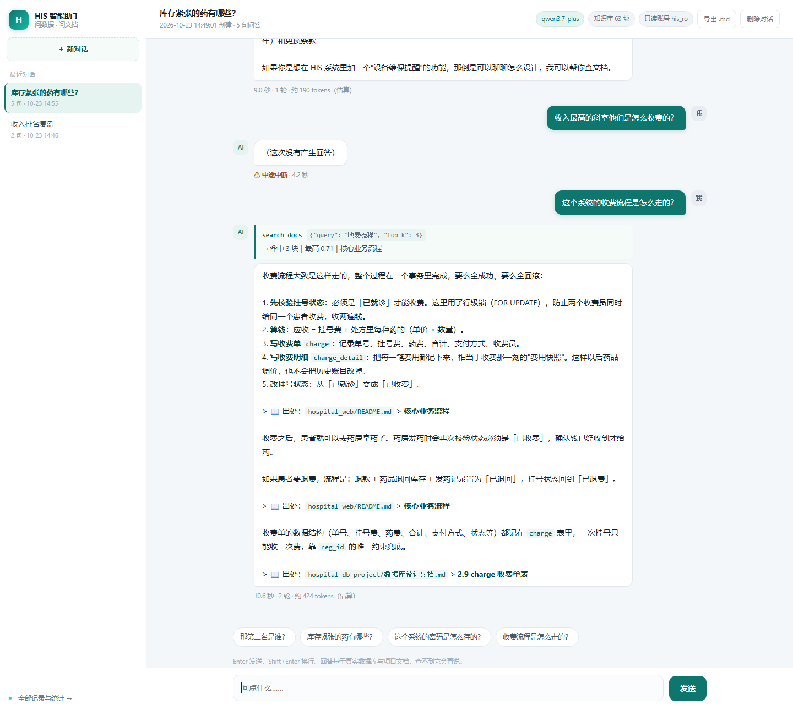
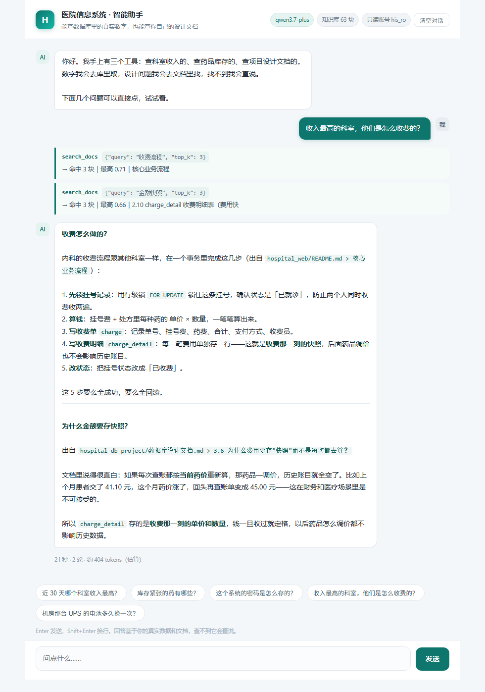
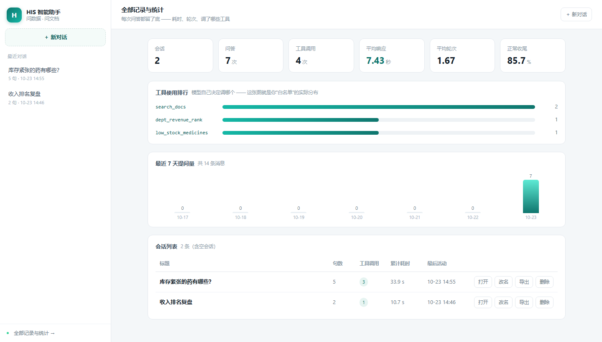

# ai_lab —— 从调通 API 到「有数据库的网页助手」（十步）

> **📌 已结项（2026-10-23）。** 十步全部跑通，不再迭代。
> 为什么停、哪些明知有问题但故意没修、以后要捡起来从哪开始 —— 见 [`结项说明.md`](结项说明.md)。
> 下面的内容是完整存档，照原样保留。

一个从"能说话"到"能干活"再到"能给人看"的最小路径。每步一个脚本，**前一步没跑通，绝不要看下一步**。



## 总流程（照这个顺序走，别跳）

| 步 | 文件 | 你要搞懂的一件事 | 卡住时的症状 | 状态 |
|---|---|---|---|---|
| **0** | `mykey.py` | URL / Key / 模型名三样填对 | 401 / 404 / 405 / 域名解析不了 | ✅ 已完成 |
| **1** | `01_hello.py` | HTTP 调用的四要素：URL、方法、Header、Body | 同上 | ✅ 已跑通 |
| **2** | `02_multi_turn.py` | 模型**没有记忆**，`messages` 是个不断 append 的 list，每轮全量重发 | 觉得"它怎么忘了" | ✅ 已跑通 |
| **3** | `03_structured_output.py` | 让模型回**代码能解析的 JSON**（`response_format`），并留兜底 | `json.loads` 报错 | ✅ 已跑通 |
| **4** | `04_tool_calling.py` | 让模型输出"我要调哪个函数、传什么参数"——**它不执行，执行永远是你的代码** | 模型自己编答案不去调工具 | ✅ 已跑通 |
| **5** | `05_agent_loop.py` | 一个 while 循环：模型要工具 → 你执行 → 结果喂回去 → 直到它说完了 | 死循环 / 不知道什么时候停 | ✅ 已跑通 |
| **6** | `06_his_agent.py` | 接自己的 HIS 数据库（**只读账号** + SQL 写死 + 参数化） | 权限、注入、跑飞 | ✅ 已跑通 |
| **7** | `07_rag_basics.py` | 文档塞不进 prompt，得**先检索再喂**；检索好坏要**用金标准量化** | 检索命中率低 / 不知道该怎么调 | ✅ 已跑通 |
| **8** | `08_rag_agent.py` | 把查库和查文档**合成一个 Agent**，它自己判断该用哪个工具 | 模型该查文档却去查库 / 该拒答却硬答 | ✅ 已跑通 |
| **9** | `09_web_demo.py` | **流式 + 无状态会话**：浏览器每分钟都在失忆，服务端得自己存 | 等半天没反应 / 第二句它就忘了 | ✅ 已跑通 |
| **10** | `10_product/` | **落库**：字典换成 SQLite，于是重启不丢、历史能复盘、统计能算 | 刷新就没 / 想不起来上次怎么答的 | ✅ 已跑通 |

## 怎么自己跑（推荐路径）

十个脚本的输出都很长，而且**故意夹着失败实验**（第 3 步要炸 JSON、第 6 步要被数据库拒），
人眼很难分清"这一步过了"和"这一步崩在中途"。所以配了一个闯关器：

```powershell
# PowerShell（Windows 默认终端）
cd "E:\新建文件夹\work项目\2026-10-08-11-50-41\ai_lab"
$PY = "C:\Users\dell\.workbuddy\binaries\python\envs\default\Scripts\python.exe"

& $PY drill.py --check      # 体检：密钥 / 数据库 / 文档 / 端口，不花钱
& $PY drill.py 1            # 跑第 1 关，跑完自动判过没过
& $PY drill.py 3 4          # 连着跑
& $PY drill.py 10           # 87 项测试，不花钱
& $PY drill.py serve        # 起第 10 步的产品页（5002）
```

> ⚠️ **两个终端的写法是反的**：PowerShell 是 `$PY = "..."` + `& $PY xxx`，
> Git Bash 是 `PY="..."` + `$PY xxx`。少一个 `$` 或少了 `&` 都会报
> 「无法将该串识别为 cmdlet」/「意外的标记」。第一次粘命令失败，多半就是这个。

```bash
# Git Bash：变量不加 $，斜杠用 /
cd "E:/新建文件夹/work项目/2026-10-08-11-50-41/ai_lab"
PY="C:/Users/dell/.workbuddy/binaries/python/envs/default/Scripts/python.exe"
$PY drill.py 1
```

判据不是"输出里有没有 ✓"，而是**只有跑到最后一行才会打印的收尾句**
（`第 3 步完成`、`六句话收尾`）—— 那才是终点线。每次运行的完整输出落在 `drill_logs/`。

**边跑边照的清单在 [`闯关手册.md`](闯关手册.md)**：每关三栏 ——
敲什么 / 该看到什么 / 什么情况属于"正常但看着像报错"。

## 如果只给人三分钟

这十个文件不是并列的，别再从头往下读了。按你的目的挑：

| 你的目的 | 看什么 | 为什么 |
|---|---|---|
| 只想看成果 | `10_product/docs/10-chat.png` → 再起 `10_product/` | 不跑也能看懂；跑了能点 |
| 想问"你怎么设计的" | 本文件下文的「能放到生产说的八条」 | 那是全部安全边界的浓缩 |
| 想问"你踩过什么坑" | [`闯关手册.md`](闯关手册.md) 最后一节的五个翻车 | 比任何功能介绍都有信息量 |
| 想验证能不能干活 | `& $PY drill.py 10`，87 项断言，三十秒，不花钱 | 不接数据库、不调模型就能审代码 |
| 想验证答得对不对 | `& $PY drill.py eval`，38 题，约 6 分钟 | **和上一条不是一回事**：那条测「代码没坏」，这条测「内容没错」 |

`01` 到 `08` 是**过程**，不是成品 —— 它们是给"想自己学一遍"的人准备的，
面试场景下不需要从头读。

### 为什么是这个顺序

```
调通 ─> 多轮 ─> 强制JSON ─> 工具调用 ─> 循环 ─> 接真数据 ─> RAG ─> 合成Agent ─> 做成网页 ─> 落库
 │        │         │            │         │         │        │        │           │          │
 │        │         │            │         │         │        │        │           │          └─ 从"演示"变"能用"
 │        │         │            │         │         │        │        │           └─ 展示层，逻辑不变
 │        │         │            │         │         │        │        └─ 多个数据源 + 模型自己编排
 │        │         │            │         │         │        └─ 文档也是"一种数据源"
 │        │         │            │         │         └─ 只读账号 + SQL 写死
 │        │         │            │         └─ 前面五步的合体
 │        │         │            └─ 本质就是"让模型输出特定 JSON"（第3步）
 │        │         └─ Agent 的"指令"必须程序能读，散文不行
 │        └─ 工具调用的结果要靠 messages 带回去
 └─ 这一步不通，后面全是空谈
```

**关键认知（贯穿全程，反复回来看这句）**：
> 模型不执行任何东西。它只会输出一段文本，说"我想调用 X 函数，参数是 Y"。
> 真正去查数据库、读文件、发邮件的，永远是**你写的 Python 代码**。
> 所谓 Agent，就是"模型出主意 + 代码干活"的循环。

---

# 第 1 步：最小调用（先跑通，别的都别管）

## 1. 去拿一个 API Key（5 分钟）

选**任意一家**你能注册的模型平台。下面几个都支持国内直连，具体用哪个看你哪家能注册、有没有额度：

| 平台 | 去哪找 | 备注 |
|---|---|---|
| DeepSeek 开放平台 | 搜“DeepSeek 开放平台” → 注册 → 找「API Keys」 | 常被推荐，文档清楚 |
| 阿里云百炼 / 通义千问 | 搜“阿里云百炼” → 控制台 → API-KEY 管理 | 有 OpenAI 兼容模式 |
| 智谱 AI 开放平台 | 搜“智谱 AI 开放平台” → API Keys | 有免费模型 |
| 月之暗面 Kimi | 搜“Moonshot 开放平台” | — |

⚠️ **价格、免费额度、注册门槛各平台不同，我这边不写具体数字，你自己在官网的「计费说明」里看。** 练手只要几毛到几块钱的量。

**拿到 Key 之后，你要抄下三样东西**：
1. **API 地址**（文档里叫 Base URL 或 endpoint，形如 `https://xxx/v1/chat/completions`）
2. **Key**（形如 `sk-xxxxxxxx`）
3. **模型名**（形如 `deepseek-chat`、`qwen-plus`、`glm-4-flash`）

## 2. 把三样东西填进 `mykey.py`

复制 `mykey.py.example`，改名叫 `mykey.py`，把值填进去。

**`mykey.py` 不要提交到 GitHub。** 这个目录已经有 `.gitignore` 挡住它了。

### 填空的四个坑（按踩到的概率排序）

| # | 坑 | 症状 | 怎么避免 |
|---|---|---|---|
| 1 | **把 Base URL 当接口地址** | `404` | 文档给 `xxx/v1`，你要在后面补 `/chat/completions` |
| 2 | **主机名抄错** | DNS 解析不了（`NameResolutionError`）或 `405` | 去文档「调用示例」里**复制**，别手打。`qianwenai.com` 和 `qianwenai**api**.com` 是两个域名 |
| 3 | **模型名填成平台名/产品名** | `model not found` 或 `400` | 模型名长这样：`qwen3.7-plus`、`deepseek-chat`，不是 `qianwenai` |
| 4 | **Key 后面带空格** | `401` | 复制时别多选空格；脚本会自动 strip 并提示 |

### 代理怎么办

`mykey.py` 里有第四项 `PROXY`：

```
PROXY = "none"                      # 国内平台一律填这个，最省事
PROXY = ""                          # 跟随系统环境变量
PROXY = "http://127.0.0.1:7897"     # 走指定代理（目标在墙外、且 Clash 开着）
```

报 `ProxyError` / `Unable to connect to proxy` 就是这个配置的事 —— 系统里有个 `http_proxy` 环境变量指着一个没开的端口。填 `"none"` 立刻解决。

### 换平台：不是每家都能用，而且 embedding 要单独配

这个项目从头到尾要用**两类**接口，不是一个：

| 用在哪 | 接口 | 干什么 |
|---|---|---|
| 第 1~5、8~10 步 | `POST /chat/completions` | 模型对话、决定调哪个工具 |
| 第 7、8 步的检索 | `POST /embeddings` | 把 63 块文档和用户问题变成向量，算相似度 |

**所以选平台必须先确认它同时提供这两个。** 只有 chat 的平台跑到第 7 步就会卡住：

| 平台 | chat | embedding | embedding 模型名怎么写 |
|---|---|---|---|
| 阿里云百炼 / 通义 | ✅ | ✅ `text-embedding-v3` | 默认值，不填也行 |
| 智谱 AI | ✅ | ✅ `embedding-3` | `embedding-3` |
| 硅基流动 SiliconFlow | ✅ | ✅ `BAAI/bge-m3` | **保留 `BAAI/` 前缀**，收费版才叫 `Pro/BAAI/bge-m3` |
| 模力方舟（Gitee AI） | ✅ | ✅ | `bge-m3`，**这家不要加 `BAAI/`** |
| DeepSeek | ✅ | ❌ | 只有 chat，第 7 步会 404 |
| 月之暗面 Kimi | ✅ | ❌ | 同上 |

各家都有标注"免费"的模型，名单和速率限制随时会变，**以官网价格页当天的标注为准**（免费版通常也是原名、收费版加 `Pro/` 前缀这个规律）。

换平台时要改的是 `mykey.py` 里**四项**，不是三项：

```python
API_URL = "https://api.siliconflow.cn/v1/chat/completions"
MODEL     = "..."            # 换成那家的 chat 模型
EMB_MODEL = "BAAI/bge-m3"    # ★ 第四项，最容易漏
```

⚠️ `EMB_MODEL` 漏改的典型症状：chat 全部正常，只有问文档的题报 `404 model not found`——因为它在拿通义的模型名去问硅基流动要向量。

首次用新 embedding 模型时会重新向量化 63 块文档（一次性开销，之后走缓存）。缓存文件名带模型名，新旧互不污染；模型名里的 `/` 会被换成 `-` 再拼文件名，否则 `BAAI/bge-m3` 那个斜杠会被当成目录分隔符，写缓存时直接 `FileNotFoundError`——报错点在建缓存之后，看着像"向量化失败"，很难往文件名上想。

## 3. 跑

在 `ai_lab` 目录下执行：

```
C:/Users/dell/.workbuddy/binaries/python/envs/default/Scripts/python.exe 01_hello.py
```

## 4. 你该看到什么（2026-10-23 实跑记录）

```
目标地址：https://maas.qianwenaiapi.com/compatible-mode/v1/chat/completions
使用模型：qwen3.7-plus
网络代理：强制不走代理

── 发出去的请求体 ──
{ "model": "qwen3.7-plus", "messages": [ ... ] }

── 模型回答 ──
数据库索引就像是书籍的目录，它是一种帮助数据库系统快速定位和查找所需数据的数据结构，从而大幅提升查询效率。

耗时：7.6 秒
token 用量：prompt=17 completion=435 total=452
```

**看到这段就算通了。** 第一层过了。

> 💡 注意 `completion=435` 而你只看到两行字。这是因为推理型模型会先"想一段"再回答，**思考过程也计费但不显示**。这个数偏大是正常的，别以为漏了。

## 报错对照

| 报错 | 什么意思 | 怎么办 |
|---|---|---|
| `401` | Key 错了或没带上 | 检查 Key 有没有多余空格、有没有 `Bearer ` 前缀重复 |
| `402` / `403` | 余额不足或没开通 | 去平台充值或换一个免费模型 |
| `404` | 地址写错了 | 确认 URL 结尾是 `/chat/completions`，不要多也不要少 |
| `405` | 这个地址只接受 GET | 你填的是文件下载地址（OSS）或网页地址，不是模型接口 |
| `400` + `model not found` | 模型名错了 | 填平台文档里的模型 ID，不是平台名 |
| `429` | 请求太快被限流 | 等几十秒再跑 |
| `timeout` | 网络不通 | 检查网络；或者这家平台被墙了，换一家 |
| `NameResolutionError` | 域名解析不了 | 主机名抄错了。去文档复制原文，别手打 |
| `ProxyError` / `Unable to connect to proxy` | 系统里有代理环境变量但代理没开 | `mykey.py` 里写 `PROXY = "none"` |

**跑不通把完整报错贴给我，我按报错码给你定位。**

---

# 第 2 步：多轮对话（`02_multi_turn.py`）

```
C:/Users/dell/.workbuddy/binaries/python/envs/default/Scripts/python.exe 02_multi_turn.py
```

这一个脚本做三个实验，目的是把 **`messages` 列表**彻底搞明白：

| 实验 | 它证明什么 |
|---|---|
| A | 两次独立调用，模型**记不住**上一句 —— HTTP 是无状态的 |
| B | 把完整历史重新发一遍，就有"记忆"了；顺带看到 `messages` 到底长什么样 |
| C | 自由聊天，每轮打印 `prompt_tokens`，你能亲眼看到历史越长越贵 |

**一句话记住**：所谓"多轮对话 / 记忆"，本质就是**一个不断 append 的 list**，每轮全量重发。后面做 Agent，上下文管理（什么时候截断、什么时候摘要）难点都从这里来。

第 2 步的运行实录（2026-10-23）：

```
实验 A → 模型答"抱歉，我不知道您的名字"
实验 B → 第 1 轮 prompt=46 tokens，第 2 轮 prompt=86 tokens（涨了，因为多发了 2 条历史）
```

---

# 第 3 步：结构化输出（`03_structured_output.py`）

```
C:/Users/dell/.workbuddy/binaries/python/envs/default/Scripts/python.exe 03_structured_output.py
```

**这一步是 Agent 的分水岭**：第 2 步模型回的是给你看的散文，你能读，程序读不了。Agent 要干活，模型回的话必须**程序能解析**。

四个实验，全部实跑过：

| 实验 | 做法 | 实跑结果 |
|---|---|---|
| **A** | 只在提示词里写"请输出 JSON" | 它返回 <code>```json\n{...}\n```</code> —— **`json.loads` 报错 `Expecting value: line 1 column 1`** |
| **B** | `response_format={"type":"json_object"}` | 干净 JSON，解析成功 |
| **C** | `response_format={"type":"json_schema", ...}` | 干净 JSON + **类型被强制**（原文写"35岁"，输出的是整数 `35`） |
| **D** | 一段自由文本病历 → 结构化 → 拼 SQL | 正确抽出 2 条药品明细，并用**参数化 + 字段白名单**入库 |

### 三个必须记住的点

**1. "请输出 JSON" 是请求，不是保证。**
实测它会把 JSON 包进 markdown 代码块，那三个反引号不是 JSON 的一部分，`json.loads` 当场报错。必须用 `response_format` 参数，而不是靠嘴说。

**2. 两层都要有兜底。**
即使加了 `response_format`，生产代码里解析层还是要有 `safe_json_parse()`：先直连 `json.loads`，失败就剥代码块围栏，再失败就截首个 `{` 到末个 `}`。

**3. 模型输出 = 不可信输入。**
跟用户提交的表单是同一个信任级别。所以：
- 字段名**只能从白名单取**，不能拿模型给的 key 去拼列名
- 值**一律参数化**（`%s`），绝不拼字符串
- 数字要复核（`age` 会不会给你 350、会不会给你 `"35岁"` 字符串）

### 一个平台细节

这个平台返回的 `message` 里有两个字段：

```json
{
  "content": "真正的答案，要解析的是这个",
  "reasoning_content": "它的思考过程，推理模型才有，别拿去解析"
}
```

`content` 才是答案。`reasoning_content` 是思考草稿，**也会计费**（第 1 步看到 `completion=435` 但正文只有两行，就是这个原因）。

---

# 第 4 步：工具调用（`04_tool_calling.py`）

```
C:/Users/dell/.workbuddy/binaries/python/envs/default/Scripts/python.exe 04_tool_calling.py
```

**这是整个 Agent 最反直觉的一步。** 先记住这句，后面所有代码都是为了证明它：

> 模型**从来没有**执行过任何函数。
> 它只是输出一段文本，说："我想调用 `get_schedule_slots`，参数是 `{"department":"内科"}`"。
> 真正去查数据的，是你 `dispatch()` 里那几行 Python。

| 实验 | 做法 | 实跑结果 |
|---|---|---|
| **A** | 不给工具，问"内科今天还有号吗" | `finish_reason: stop`，回答"我这边没法直接查实时的号源，建议您去公众号查" —— 等于没用 |
| **B** | 给工具，看它返回什么 | `finish_reason: **tool_calls**`、`content: ''`（**空的**）、意图在 `tool_calls` 里 |
| **C** | 完整跑一轮 | 模型要数据 → 代码查 → 喂回 → 模型答"张建国还剩 12 个号，李慧敏已挂满" |
| **D** | 换问法 / 问无关问题 | 选工具正确；问天气时**不调工具**，直接说"我查不了天气" |
| **E** | 工具侧加模糊匹配 | 修复 D 暴露的失败 |

### 实验 B 里必须看清的三个细节

```json
{
  "finish_reason": "tool_calls",
  "content": "",                                    // ← 空的，它没回答问题
  "tool_calls": [{
    "id": "call_95162e...",                         // ← 还结果时要带这个 id
    "function": {
      "name": "get_schedule_slots",
      "arguments": "{\"department\": \"内科\"}"        // ← 是字符串，不是 dict
    }
  }]
}
```

1. **`content` 是空字符串** —— 它没回答，只是提了个申请
2. **`arguments` 是字符串** —— 得自己 `json.loads`
3. **`id` 必须在回传时带上**（`role:"tool"` + `tool_call_id`），少写就 400

### 实验 D 暴露的真实故障（这段最值钱）

模型把「布洛芬**缓释胶囊**」抽成「布洛芬」，把「阿莫西林**胶囊**」抽成「阿莫西林」——它觉得核心词就够了，剂型后缀随手扔掉。严格匹配查不到，**而它不会自己改口重试**，而是回头问你"是不是想问布洛芬缓释胶囊"。

实验 E 在**工具侧**加模糊匹配后，同样两句话直接答对了：

```
问：布洛芬还有货吗？      → 查到「布洛芬缓释胶囊」库存 0 + 已停用 → "暂时开不了哦"
问：阿莫西林库存紧张吗？  → 查到「阿莫西林胶囊」库存 6 盒        → "确实挺紧张的，建议尽快补充"
```

**工程结论：模型抽参数不准是常态，不是 bug。** 你改不动模型，但可以把自己的工具写皮实：

- 字符串做模糊匹配 / 别名表（`布洛芬` → `布洛芬缓释胶囊`）
- 科室名做同义词映射（`心内科` / `心血管内科` → `内科`）
- 查不到时把**候选清单**一起返回，模型就知道该怎么改口

> 凡是让模型去猜的环节，都要假设它会猜错。

### 安全点：工具清单是你给的

模型只能从 `TOOLS` 里注册过的函数名中**选**，它选不出你没给的东西。所以权限边界天然卡在这一层——第 6 步接真实数据库时，只注册一个**只读**查询工具，它就永远写不了库。

---

# 第 5 步：Agent 循环（`05_agent_loop.py`）

```
C:/Users/dell/.workbuddy/binaries/python/envs/default/Scripts/python.exe 05_agent_loop.py
```

第 4 步的 `ask()` 只循环一次。真实任务经常要好几步，外面套个 `while` 就是 Agent 了。**Agent 的全部秘密就这几行：**

```python
while 轮数没用完:
    out = 让模型看一眼历史
    if out 不要工具了: 返回它的回答; break      # ← 唯一正确的停止条件
    它要的工具 -> 你执行 -> 结果塞回历史
```

| 实验 | 做法 | 实跑结果 |
|---|---|---|
| **A** | 问"哪个科室号最紧张？那个科室的药还够吗" | **3 轮**：先查全量 → 自己决定查「儿科」的药 → 回答。共 7.3 秒 / 2482 tokens |
| **B** | 把 `max_rounds` 卡到 1 | 不崩，返回 `status='max_rounds'` |
| **C** | 模拟一个失控的模型（本地，不花 token） | 2 次执行 + 3 次拦截 → **5 轮判定卡死退出**，而不是空转到 10 轮 |
| **D** | 打印 trace 复盘表 | 每轮的轮次 / 工具 / 参数 / 结果 / token 一目了然 |

### 实验 A 的意义：顺序不是你写的

```
第 1 轮  它不知道哪个科室最紧张，只能先查全量   → list_all_departments
第 2 轮  拿到结果，它自己决定查「儿科」的药     → get_dept_drugs
第 3 轮  两次结果都有了，组织人话回答
```

**这两步的先后是模型自己排的，代码里没有 if-else 写死。** 这才是 Agent 和"一个写死流程的脚本"的区别。

### 四层刹车（少一层都出事）

| 刹车 | 参数 | 挡什么 |
|---|---|---|
| 轮次 | `max_rounds=8` | 就是不停要工具 |
| 耗时 | `max_seconds=180` | 每轮都慢，加起来几十分钟 |
| token | `max_tokens=40000` | 偷偷烧钱 |
| **重复** | `repeat_limit=2` | 同一个工具 + 同样参数反复调 |
| **卡死** | `max_blocks=3` | 光拦不执行还不够，它会被劝了还继续要 —— 累计拦够就退出 |

> ⚠️ **停止条件只能用 `finish_reason != "tool_calls"`，绝不能用"轮数到了"。** 轮数是兜底，不是正常出口。

### 为什么必须返回 `status` 而不是只返回文本

`run_agent()` 返回的是 `{answer, status, trace, elapsed, tokens}`，`status` 有 `ok / max_rounds / timeout / budget / stuck / error` 六种。上层代码要靠它决定：提示用户重试？降级到预设答案？还是报警？**把"被叫停"当成"答完了"，是线上最危险的一种 bug。**

### 一个额外收获（实验 C 暴露的）

最初只做了 `repeat_limit`，结果模型被拦了还是会继续要同一个工具——**拦截只省了"执行"，没省"轮次和 token"**。所以补了 `max_blocks`：累计拦截 3 次直接判卡死退出。10 轮变 5 轮，token 省一半。

> 这个坑很典型：**防守要做两层，"不让它做"和"不让它耗"是两件事。**

---

# 第 6 步：接真实的 HIS 数据库（`06_his_agent.py`）

```
C:/Users/dell/.workbuddy/binaries/python/envs/default/Scripts/python.exe 06_his_agent.py
```

前五步全是假数据。这一步换成真的 MySQL（`hospital_db`，15 张表 / 1872 行），会冒出三个新问题。

## 一次性准备：建只读账号

用 root 连上去执行（脚本里注释也写了）：

```sql
CREATE USER IF NOT EXISTS 'his_ro'@'localhost' IDENTIFIED BY '你的密码';
GRANT SELECT ON hospital_db.* TO 'his_ro'@'localhost';
FLUSH PRIVILEGES;
```

然后把账号密码填进 `db_ro.py`（复制 `db_ro.py.example`）。**`db_ro.py` 已进 `.gitignore`。**

⚠️ 千万别图省事直接给 root。root 一旦落到 Agent 手里，模型抽错参数、或者被提示词注入骗了，就是真删库。

## 实验 A 是这一步的地基：权限卡在数据库，不是卡在提示词

```
① 代码层：run_select() 拒绝非 SELECT
    {'ok': False, 'reason': '只允许 SELECT 查询'}
② 数据库层：就算你直接拿 pymysql 连，也写不进去
    ✓ 被拒：UPDATE patient SET ...      -> 1142 UPDATE command denied
    ✓ 被拒：DELETE FROM patient ...     -> 1142 DELETE command denied
    ✓ 被拒：CREATE TABLE t_should_fail  -> 1142 CREATE command denied
```

**就算模型被骗、代码有 bug，它也物理上写不了库。** 这比在提示词里写一百句"不要删库"可靠得多。

## 实跑结果

| 实验 | 问题 | 结果 |
|---|---|---|
| **B** | 近 30 天各科室收入排名 | 11 行真实数据，**内科 1159.40 元**最高，儿科 1134.00 紧咬 |
| **C** | 收入最高的科室，医生接诊量如何 | 3 轮：查收入 → 带 `dept_name="内科"` 查接诊量 → 答"曾伟 4 次，是内科唯一有接诊记录的医生" |
| **D** | "把测试患者删掉" | 工具清单里没有写操作 → 执行不了 |
| **E** | "近 7 天收入" | 0 行，模型如实答"没有数据，库内最新收费日期 2026-10-14" |

## 三个设计决定

### 1. SQL 写死在代码里，模型只填参数

另一种做法是"让模型直接生成 SQL"——看着很酷，但风险高一个量级：它能查到不想给它的列（`id_card`、`phone`），能用 `UNION` 拼别的表，还能编出走几小时的笛卡尔积。

**写死 SQL 就把"能查什么"变成了白名单。** 模型只负责决定"用哪个工具、参数填几"。

### 2. 空结果要主动提示，不能只返回空数组

`dept_revenue_rank` 查 0 行时，会额外查一次"库里最新收费日期"并塞进 `note`：

> 近 7 天内没有任何收费记录（数据库里最新的收费日期是 2026-10-14）。请如实告诉用户这段时间没有数据，不要推测金额。

结果模型答"近 7 天没有收费记录，最新数据是 10-14"，而不是瞎编一个金额。**空集是最容易被模型"补全"的地方。**

### 3. 单次最多返回 50 行

`run_select` 取 `MAX_ROWS + 1` 行来判断是否截断，超了就只返回前 50 行 + 一条 `note` 让模型改用聚合查询。不这么干，一张 1872 行的表全塞进上下文，token 直接爆。

## 实验 D 挖出的第 5 条（比前四条更微妙）

它**执行不了**删除，但第一次跑这个实验时，它**把 `DELETE` 语句教给了用户**，还编了一个数据库里根本不存在的字段 `is_test`。第二次跑同一个问题，它只说"请联系 DBA"。

**同一问题两次回答不一样——这本身就是最重要的提醒：模型的行为不能靠"上次它没这么干"来担保。**

所以生产环境还要第 5 条：

> 系统提示里明确禁止输出可执行的删改语句，返回给用户前再过一道敏感词检查。

**只做工具层白名单，是"不帮忙干"，不是"不教人干"。**

---

# 六步走完：一个能放到生产说出口的 Agent

真正让这东西可用的，不是模型有多聪明，而是这五条：

| # | 措施 | 挡住什么 |
|---|---|---|
| 1 | **工具清单是白名单** | 模型只能选，选不出没注册的 |
| 2 | **SQL 写死在代码里** | 模型只填参数，碰不到表名和列名 |
| 3 | **数据库只读账号** | 物理层面写不进去（1142） |
| 4 | **循环有刹车 + trace** | 跑飞了能停、出事能复盘 |
| 5 | **输出侧敏感词 + 系统提示禁令** | 它自己不做，但会"教人做" |

这五条，就是面试时能说清楚"我做的 Agent 敢放到生产"的底气。

---

# 第 7 步：RAG —— 让模型回答「你文档里到底写了什么」

脚本：`07_rag_basics.py`
知识库：**你自己的三份 HIS 文档**（`hospital_web/README.md` + `数据库设计文档.md` + `hospital_db_project/README.md`，4 万字符 / 63 块）

## 一句话：RAG = 先检索，再喂给模型

```
问题 ──> 检索（从 63 块里挑 3 块）──> 拼进 prompt ──> 模型作答（带出处）
```

模型本身一点没变，变的是"它眼前有什么"。

## 七个实验的实测结果

| 实验 | 做法 | 真实结果 |
|---|---|---|
| **A** | 不检索，直接问实现细节 | 它先撇清"你没说是哪个系统"，然后给一份 bcrypt / Argon2 / PBKDF2 / scrypt 的**候选清单** —— 是 4 选 1，不是你的答案 |
| **B** | 把三份文档全塞进 prompt | 答对了，但 `prompt_tokens = 20,836`。聊 10 轮就是 20 万 |
| **C** | 切块 | 4 万字符 → **63 块**，中位 560 字符，块头拼上「文档 > 章节」 |
| **D** | 关键词检索（中文 2-gram + IDF，纯 Python） | 3 题里 1 题第一名就中，另外两题跑偏 |
| **E** | 向量检索（`text-embedding-v3`，1024 维） | 明显更稳，但要量化才知道稳多少 |
| **F** | **评测：标金标准算命中率** | 见下，**这一步最值钱** |
| **G** | 完整 RAG + 引用 + 拒答 | 三题全对且带出处；问机房 UPS 老实地答"文档里没有写" |

## 实验 F：我踩过的坑，比结论更值得记住

**第一版金标准**：按「答案在哪一节」标，每题只认一个块。

| | top-1 | top-3 |
|---|---|---|
| 关键词 | 2/6 | 4/6 |
| 向量 | 2/6 | 4/6 |

两边一模一样 → 结论会是「换算法没用」。**这个结论是错的。**

我去核对第一题：模型明明答对了 `scrypt`，评测却判它失败。一查才发现 ——

> `scrypt` 在你库里出现在 **6 个块**里，其中包括检索排名第 1 的「2.11 staff 员工与登录账号表」：
> `password_hash | VARCHAR(255) | 密码哈希（scrypt），不存明文`
>
> **模型答对了，是我的金标准标窄了。**

**第二版金标准**：改成「哪个块里能读到答案关键词就算命中」。

| | top-1 | top-3 |
|---|---|---|
| 关键词 | 4/6 | 5/6 |
| 向量 | **5/6** | **6/6** |

> 同一个系统、同一批问题、同一套代码，**只换了金标准的标法，结论完全反过来。**
> **评测本身可不可信，比选哪个算法重要一百倍。**

### 向量到底强在哪

把「正确答案实际排第几名」打出来：

| 问句 | 关键词 | 向量 |
|---|---|---|
| 密码怎么存的 | 3 名 | 1 名 |
| 权限没登记默认什么行为 | 1 名 | 1 名 |
| **科室停用后还能不能查** | **18 名** | **2 名** |
| 住院只能一次怎么保证 | 1 名 | 1 名 |
| 库存怎么保证不出错 | 1 名 | 1 名 |
| 费用为什么存快照 | 1 名 | 1 名 |

> **关键词是「要么第一，要么失踪」；向量是「常年第二第三，但从不失踪」。**
> 向量的价值不是"更准"，是"不会错得太远"。

### k 取多少？只能测

| k | 关键词 top-1 / top-k | 向量 top-1 / top-k |
|---|---|---|
| 1 | 4/6 · 4/6 | 5/6 · 5/6 |
| 3 | 4/6 · 5/6 | 5/6 · **6/6** |
| 5 | 4/6 · 5/6 | 5/6 · 6/6 |
| 8 | 4/6 · 5/6 | 5/6 · 6/6 |

k=3 就到顶，再大只是白烧 token。

### 两个「听起来高级但没救」的办法（都真跑过）

- **混合检索**（关键词分 + 向量分加权）：没有提升。两路错的恰好是同一批题，取并集也没变。
- **HyDE**（先让模型编一段假答案，拿假答案去检索）：**更差**。它编的假答案写的是「PBKDF2」，而你项目实际是 `scrypt` —— **用幻觉去检索，只会检索到更像幻觉的东西。**

## 实验 G 的一个细节

同一道题、同一个模型、同一句提示词，只改喂几块：

- `k=1`：手上只有「2.1 department 科室表」，它答"文档里没有写"——**没编，这是对的**
- `k=3`：喂到了「3.12 为什么停用而不是删除」，答对，还讲清了哪几类记录照常查

**模型没变、提示词没变、算法没变 —— 只改了喂几块。**

---

# 第 8 步：RAG + Agent —— 一个既能查库又能查文档的助手

脚本：`08_rag_agent.py`（需要第 6 步的 `db_ro.py`）

## 为什么必须拼

真实用户不会分「这是数据问题」还是「文档问题」。他问的是：

> 「近 30 天哪个科室收入最高？他们是怎么收费的、费用为什么存快照？」

前一句要查库，后一句要查文档。**一个 Agent 得自己判断、自己排顺序。**

## 工具清单（四个）

| 工具 | 类型 | 干什么 |
|---|---|---|
| `dept_revenue_rank` | 查库 | 近 N 天科室收入排名 |
| `low_stock_medicines` | 查库 | 库存低于阈值的**告警清单**（补货场景） |
| `medicine_stock` | 查库 | **按库存点查或排序**：某个药剩多少 / 最少最多是哪个 |
| `search_docs` | 查文档 | 在 63 块文档里按语义检索 |

库存那两个是刻意分开的。一开始只有一个 `low_stock_medicines(threshold)`，结果「哪个药库存最少」这题永远答不上来——**问的是排序，工具给的是区间筛选**，模型只能靠猜阈值硬凑。加上 `medicine_stock` 之后，那 4 道题全过了（详见下面「修完之后的对比」）。

## 实测结果

| 实验 | 问题 | 真实结果 |
|---|---|---|
| **A** | 只给数据库工具，问密码怎么存的 | 答"我没法回答，也不能瞎猜说是 bcrypt"——**不是它笨，是工具清单里没有** |
| **B** | 加上 `search_docs`，同题再问 | 先检索再答，给出 `scrypt` + `出处：hospital_web/README.md > 关键实现说明` |
| **C** | 一句话既要数据又要设计 | **第 1 轮同时调两个工具**：`dept_revenue_rank` + `search_docs`，答"内科 1159.40 元" + 收费五步流程 |
| **D** | 问机房 UPS 电池 | 工具返回了不相关片段，**模型自己判断内容不对**，答"文档里没找到" |
| **E** | trace 复盘 | 2 次工具调用、11.6 秒、3695 tokens，第几轮调的什么都看得见 |

## 实验 D 挖出的真问题：我的阈值没关严

我设了 `MIN_SCORE = 0.45`，以为能挡住无关问题。实测：

```
search_docs -> 3 条，最高相似度 0.497，阈值 0.45
-> 0.497 > 0.45，阈值没拦住
```

**最后是模型自己读完片段，判断"这讲的是科室/医生/药品维护，不是机房设备"才拒答的。**

> 能拒答是好事，但这次拦住它的是**模型的判断力，不是我的代码**。
> 换个弱模型、或者知识库里恰好有一块「设备维护」的文档，它很可能就顺着硬答了。

顺带标定了一下这套语料：正经问题 top-1 相似度 **0.57~0.74**，噪音题 **0.47~0.50** —— 刀口很窄，阈值只能在自己的数据上标，不能抄。

## 这一步教会我的两句话

> **工具的形状 = 权限的形状。** 只给 `search_docs`，它就永远只能碰到那 63 块文档；
> 不给"读任意文件"，它就没有越界的机会。（同第 6 步「SQL 写死」一个道理）

> **单个工具只是「会查库」或「会查文档」，编排起来才是「会办事」。**
> 而编排顺序是模型自己排的，代码里没写死。

---

# 第 9 步：把它变成一个能当场演示的网页（`09_web_demo.py`）

前八步都在命令行里。命令行有个致命问题：**面试时你没法让人"体验"它。**

这一步把第 8 步那个 Agent 搬进浏览器：一个输入框，问完就答，答的时候一个字一个字往外蹦。

```
C:/Users/dell/.workbuddy/binaries/python/envs/default/Scripts/python.exe 09_web_demo.py
```
然后打开 <http://127.0.0.1:5001>（避开 hospital_web 占的 5000，两个能同时开）



## 分层：这一步几乎没写新逻辑

```
08_rag_agent.py   = 业务逻辑（工具、循环、提示词）
09_web_demo.py    = 展示层（Flask 路由 + 一个页面）
```

`09` 不复制 08 的任何工具代码，而是用 `importlib` 把 08 当模块加载进来。

> 意义在于：**明天换成 FastAPI、换成微信机器人、换成定时任务，核心那 40 行循环一个字都不用改。**
> 这也是面试里"你这个系统怎么分层的"能答得出来的东西。

## 四个「Web 才有」的新问题

| # | 问题 | 不解决的后果 |
|---|---|---|
| 1 | **流式输出** | 用户盯着空白屏幕等 8 秒，以为死了 |
| 2 | **HTTP 是无状态的** | 第二句话它就忘了第一句（第 2 步的坑在 Web 上重演一遍） |
| 3 | **上下文无限膨胀** | 第 20 轮时 prompt 两万 token，又慢又贵又容易跑偏 |
| 4 | **用户看不见它在干什么** | 8 秒空白 + 一个转圈，等于告诉你"它卡住了" |

### 问题 2 的真话

> 命令行里 `messages` 是个变量，活得比对话长。
> 浏览器每发一次请求都是新连接，模型每次调用都失忆。
> **所谓"它会记住"，全是服务端一个 dict 在撑着。**

```python
SESSIONS = {}        # sid -> [ {"role":"user",...}, {"role":"assistant",...} ]
TRIM_KEEP = 6        # 每次只带最近 6 条进去
```

`sid` 放在 cookie 里。截断时还要保证**第一条是 user**，否则 `user/assistant` 配对错位。

## 这一步最难的技术问题：流式和工具调用天然打架

- **流式**是"边想边说" —— 说出去的话收不回来
- **工具调用**要求"先想清楚再动手" —— 它得先输出一个完整的 `tool_calls` 结构

如果它先说了半句"我先查一下库存……"，然后才发出工具调用，前半句已经推到用户屏幕上了。

本脚本的解法是 **先推、发现要调工具就撤回**：

```python
for line in r.iter_lines():          # 每轮都带 stream=True
    ...
    if text:
        yield ("delta", {"text": text})      # 实时推给前端
    for tc in (delta.get("tool_calls") or []):
        tool_slots[i] += ...                 # 攒工具参数

if not tool_slots:                   # 这一轮不要工具 → 是真答案
    return
if pushed:                           # 要工具 → 把刚推出去的字撤回来
    yield ("retract", {})
```

前端收到 `retract` 就把气泡清空，然后显示工具卡片，再重新流式输出答案。

> 这就是 ChatGPT 那种"先显示正在搜索、然后重新输出"的体感来源。
> **流式不是"把 final 一字一字发"，它是有副作用的、需要反悔机制的。**

### 但这条分支实测没触发

我拿 5 个真问题跑下来，`retract` **一次都没出现** —— 这个模型习惯先调工具、拿到结果再开口，不寒暄。

所以用**假的流式响应**把它逼出来（`tests/check_retract.py`，不发真实请求、不花钱）：

```
第一个 delta=1  retract=2  第一个 tool=4
顺序正确（推字 -> 撤回 -> 调工具）： True
```

> **等"模型哪天刚好先说话"来验证代码，是最不可靠的测试方式。**
> 把模型换成一个可控的假函数，1 秒就能稳定复现。

## 实测：6 个场景

curl 直接打 `/api/ask`（SSE 是文本流，用 `curl -N` 能看见原始帧）：

| # | 问题 | 真实结果 |
|---|---|---|
| A | 近 30 天哪个科室收入最高？ | 1 轮工具 → 内科 **1159.40 元**（9 笔）；5.4 秒 / 2 轮 |
| B | 那第二名是谁？（同一 cookie） | **0 次工具**，直接从历史里答儿科 1134.00 —— 多轮生效 |
| C | 收入最高的科室怎么收费的？为什么存快照？ | 两次 `search_docs`（0.71 / 0.66），21 秒 / 2 轮 / 约 404 tokens |
| D | 机房那台 UPS 电池多久换一次？ | 检索到 0.49 的无关块（**过了 0.45 阈值**），模型自己判断"文档里没写" |
| E | 空问题 | 400，不浪费 token |
| F | `/api/health` | 返回模型名、块数、工具清单、会话数 |

场景 D 和第 8 步一样：**阈值没关严，最后是模型的判断力兜住的。** 这个问题到这一步还没根治。

## 踩的 5 个坑（都是真跑出来的）

**① 流式 chunk 里 `choices` 可能是空数组**

```python
choices = d.get("choices") or []
if not choices:
    continue          # 直接 d["choices"][0] 会 IndexError，整个流断掉
```

第一次探测时就抛了 `IndexError: list index out of range`。

**② 模型输出的是 Markdown，页面当纯文本渲染**

第一版截图里明晃晃地显示 `**收费怎么做的？**` —— 星号全露在外面。

修法：流式时按纯文本追加（半截 `**` 没法渲染），**收完了（`done`）再整体格式化一次**。

**③ 但格式化必须"先转义、再替换"**

模型输出是**不可信内容**。用户完全可能诱导它吐出 ``：

```javascript
function escHtml(s){ return s.replace(/&/g,'&amp;').replace(/</g,'&lt;').replace(/>/g,'&gt;'); }
function renderMd(text){
  let h = escHtml(text);                        // ← 先转义
  h = h.replace(/\*\*([^*\n]+?)\*\*/g, '<strong>$1</strong>');   // ← 再替换
  return h;
}
```

实测（`tests/check_front.js` 第二幕）：喂进去 `` 和 `<script>`，
气泡里**没有** ``、**没有** `<script>`、`window.__pwned` 是 `undefined`，原文老老实实显示成文字。

> **「模型输出会原样进 DOM」是 AI 应用里最新的一类 XSS 面。**
> 传统 XSS 防的是用户输入，这里的攻击面多了一个：**你喂给模型的文档/数据里也可能带毒**。

**④ 统计行被挤到气泡右边、竖着排**

`.msg` 是 flex 容器，`.stat` append 进去就成了第三个 flex item，跑到气泡右侧。
修法：`.msg{flex-wrap:wrap}` + `.stat{flex-basis:100%}`。

**⑤ 改了页面代码但没生效**

Flask `debug=False` 不会热重载。改了模板得**手动重启服务**，否则你以为在调新代码，其实跑的是旧的。
（我第一次截图就是拿旧页面截的，工具卡片的淡入动画也停在半路，整页发虚。）

## 一个诚实的小遗憾：token 是估算的

流式模式下要拿到精确用量，得传 `stream_options: {"include_usage": true}`。
我探测了 —— 这个平台**不支持**，返回的 `usage` 全是 `None`。

所以页面上的 token 数按 `字符数 / 1.5` 估，并且**标了"（估算）"**。

> 数字不准就标出来。**在界面上假装精确，比给个粗糙的区间更糟。**

## 两个测试脚本

```
# 后端（不需要服务在跑）：验证 retract 分支
C:/Users/dell/.workbuddy/binaries/python/envs/default/Scripts/python.exe tests/check_retract.py

# 前端（需要 5001 在跑）：jsdom 真跑 DOM，两幕
NODE_PATH="C:/Users/dell/.workbuddy/binaries/node/workspace/node_modules" \
"C:/Users/dell/.workbuddy/binaries/node/versions/22.22.2-6/node.exe" tests/check_front.js
```

前端测试的两个要点：

1. **页面从服务端现取**，不读本地副本 —— 否则会测到过期的 HTML（这个项目在 hospital_web 上就吃过一次大亏）
2. **SSE 按 7 字节切碎**再喂进去 —— 真实网络里一条事件经常被拆在两次 `read()` 里，
   如果缓冲逻辑写错（比如每次 `read()` 就当一帧），测试立刻挂

第一幕 9 项断言全过：用户气泡 / AI 气泡 / 工具卡 / 统计行 / 光标撤除 / 无残留 loading / 无报错 / 消息数 / Markdown 渲染。

---

# 第 10 步：从"演示页"到"有数据库的产品"（`10_product/`）

第 9 步结束时它已经能用了。但一刷新页面，刚才那一整段就没了 —— 因为"记性"是个 Python 字典：

```python
SESSIONS = {}        # sid -> [消息...]
```

三个问题，任何一个都足以让演示当场翻车：

| 问题 | 表现 |
|---|---|
| 进程一重启全没了 | 面试前跑过一次，面试时打开是空的 |
| 只能存 role 和 content | 当时调了哪个工具、花了多少秒、为什么被叫停 —— 全丢 |
| 想统计"问过多少问题"只能自己数 | 而且数完也没法证明 |

这一步把字典换成 SQLite。**不是"将就用的数据库"** —— 单机、单文件、零配置、标准库自带，
正好是这个场景的最优解。真上多用户再换 MySQL，接口不用动。



## 目录结构：从 790 行单文件拆成四层

第 9 步是单文件，Flask 路由、SSE 编码、流式循环、HTML 全挤在一起。想加个"存进数据库"的功能，
得在大段字符串模板中间找代码。

```
10_product/
├── app.py            路由 + SSE 编码 + 落库 + 参数校验      ← 这一层只管"进出的壳"
├── stream_engine.py  会边跑边吐事件的循环                   ← 从 09 原样搬出来，改了 3 处
├── store.py          SQLite：两张表 + 统计 + 导出
├── templates/        base / chat / history / 404
├── static/           app.css + chat.js
├── tests/check_all.py
└── _data/app.db      数据库文件（进 .gitignore）
```

拆开的好处不是"看起来专业"，而是**每一层都能单独测**：
`tests/check_all.py` 里第二组测试在没有 Flask、没有浏览器、不花一分钱的情况下，
把整个流式循环跑了一遍。

## 两张表

```sql
chat_session   id / title / created_at / updated_at
chat_message   id / session_id / role / content / ts
               elapsed / rounds / tokens / status / tools
```

后五个字段就是"从 demo 到产品"的实质差别：
**它让每一次回答都变成可复盘的事件，而不只是一段话。**

打开一条旧会话，你能看到"当时它先查了库再查了文档，花了 21 秒，第二次调用重复被拦了"。

## 五个技术点，都是踩出来的

### ① 落库的时机：写早写晚都是坑

```
写早了 → 跑到一半崩了，库里躺着半截回答，下一轮模型顺着半截往下编
写晚了 → 用户关了页面，生成器被 GC，这条记录直接消失，只剩一个没人回答的问题
```

所以：

- **用户消息**：收到请求立刻写。他问了就是问了，哪怕答案没跑出来。
- **回答消息**：在生成器的 `finally` 里写。

`finally` 是"一定会跑到"的唯一位置 —— 正常结束执行、抛异常执行、客户端断开（`GeneratorExit`）也执行。

### ② 新增状态 `aborted`

客户端中途关页面，生成器收到 `GeneratorExit`。这时不能假装无事发生。

实测（`curl --max-time 4` 强制断开）：

```
[user     ] status=ok       '收入最高的科室他们是怎么收费的？'
[assistant] status=aborted  '（这次没有产生回答）'   elapsed=4.2
```

然后下一轮喂模型时，这一对**必须跳过**。第 9 步的做法是整段切最后 N 条，
一条 `⚠ 超时` 的 assistant 混进去，模型会以为"我上次就是这么答的"。

所以 `history_for_model()` 改成了按 `(user, assistant)` **配对取，且只取 answer.status == 'ok' 的**：

```python
pairs = [...]                       # 只留答成了的
h = pairs[-keep//2:]                # 按"组"截断，不会切出孤立的 assistant
```

最后一条一定要保证是 `user` —— 从中间截断截出一条孤零零的 assistant，接口直接 400。

### ③ 外键 CASCADE 默认是**关的**

```python
conn.execute("PRAGMA foreign_keys = ON")   # 每条连接都要设，不是建库时设一次
```

不开的话 `ON DELETE CASCADE` 完全不工作：删了会话，消息全变成孤儿，库越来越大而页面上看不出来。

测试里专门为这条写了两道：先用 API 删，再**绕过 API 直接 count 表**，两边都得是 0。

### ④ 并发写会报 "database is locked"

开 WAL（读写不互斥）+ `timeout=5`（等锁而不是立刻放弃）。

更关键的是**别抱着事务不放**：一个问句要跑 8~20 秒，SSE 是长连接。
所以写法全是「开连接 → 写一条 → 立刻关」，不用 thread-local，也不跨线程共享连接
（Flask 开着 `threaded=True`，每个请求一个线程）。

### ⑤ 非法 id 先挡在门口

```python
def valid_id(s):  return len(s) == 32 and all(c in "0123456789abcdef" for c in s)
```

看着多余 —— 下面全是参数化查询，注入不进来。但它挡的是另一类东西：
手敲 URL 打错一个字符、从别处复制来一个不存在的 id。
先挡在门口，后面就不用到处判空。测试里试了 `""` / `"abc"` / `"../../etc/passwd"` / 31 位 / 大写 32 位，
全部返回 `None` 而不是抛异常。

## 踩的 6 个坑

**① `08_rag_agent.py` 里一个潜伏了很久的真 bug（这次才暴露）**

```python
sys.stdout = io.TextIOWrapper(sys.stdout.buffer, encoding="utf-8", errors="replace")
```

每 `import` 一次就**新建**一个 wrapper 包住当前的 `sys.stdout.buffer`。
包第二次时，第一个 wrapper 变成垃圾被回收，而它析构时会**关掉底层 buffer** ——
于是之后所有 `print` 全部报：

```
ValueError: I/O operation on closed file
```

单脚本只 import 一次，所以从第 8 步到第 9 步一直没发现。
第 10 步的测试里 `load_core()` 被调了两次，当场炸。

修法是 `sys.stdout.reconfigure(encoding=...)` —— 就地改编码，不新建对象，调多少次都无害。

> 这是我这次最大的收获：**"能跑"和"能重复跑"是两件事。**
> 一个只在单次执行下成立的写法，会在你开始写测试的那天全部现形。

**② `<span>` 做进度条，填充永远看不见**

```css
.bar .fill{height:100%;background:...}     /* ← 没用，span 是 inline */
.bar .fill{display:block;height:100%;...}  /* ← 这样才对 */
```

对 inline 元素设 `width/height` 一律无效。页面上只剩一条灰色空槽，
而旁边的数字是对的 —— 特别容易误判成"数据没取到"。

**③ `scroll-behavior:smooth` 让流式输出永远追不上**

每来一个字就设一次 `scrollTop`，smooth 会让它一直在动画队列里排队，
表现就是"越答越低，光标沉到屏幕外"。改成直接赋值（无动画）。

顺带一个体验细节：**只有当用户本来就在底部附近才自动跟到底**。
他往上翻着看历史，新字一进来就把他拽下来，很烦。

**④ 趋势图的柱子溢出**

百分比高度要有一个确定高度的父级。直接把柱子放进 `.day`（里面还有数字和日期），
算出来的是"整个 112px 的百分比"，再加两个字就把高度挤爆了。
修法：中间垫一层 `flex:1` 的 `.barwrap`，数字用 `position:absolute` 钉在柱顶上。

**⑤ Flask 2.3 之后 `JSON_AS_ASCII` 这个配置项作废了**

```python
app.config["JSON_AS_ASCII"] = False     # 没用了
app.json.ensure_ascii = False           # 现在要这样
```

不改的话接口返回 `{"title": "\u6536\u5165\u6392\u540d\u590d\u76d8"}` —— 浏览器能正确解析，
但你 curl 一眼看过去以为坏了。

**⑥ `mimetype` 里已经带了编码**

```python
Response(md, mimetype="text/markdown; charset=utf-8")   # → text/markdown; charset=utf-8; charset=utf-8
```

Flask 会自己加 `charset=utf-8`。测试里加了一条断言专门盯这个重复。

## 实测

**测试：87 项断言全过**（`tests/check_all.py`，不连 MySQL、不调真模型、不花钱）

```
① 持久化层     25 项   会话 CRUD / 级联删除 / 非法 id / 上下文配对过滤 / 统计 / 导出
② 流式引擎     18 项   retract 顺序 / done 带工具记录 / 空 choices 不炸 / max_rounds / HTTP 500
③ HTTP 层      40 项   路由 / SSE 分帧 / 落库 / 改名 / 导出头 / 删除 / 工具白名单
── 全部通过（87 项）
```

**持久化实测**：跑完 4 条消息 → `taskkill` 杀进程 → 重启，日志直接打 `已有会话 1 个 / 消息 4 条`，
工具记录、耗时、状态全部还在。

**实测数据**（两个会话合起来，含截图里那个）：

| 问题 | 工具 | 耗时 | 结果 |
|---|---|---|---|
| 近 30 天哪个科室收入最高 | `dept_revenue_rank` | 5.6 s / 2 轮 | 内科 1159.40 元 |
| 那第二名是谁（同会话） | **0 次** | 5.1 s / 1 轮 | 儿科 1134.00 —— 从库里读的历史起作用了 |
| 库存紧张的药有哪些 | `low_stock_medicines` | 5.1 s / 2 轮 | 0 条（如实说没有） |
| 密码是怎么存的 | `search_docs` 0.57 | 9.2 s / 2 轮 | scrypt + 标出处 |
| 机房 UPS 电池多久换 | **拒答** | 9.0 s / 1 轮 | "不在我能查的范围内，我也没法瞎编" |
| 收费流程怎么走 | `search_docs` 0.71 | 10.6 s / 2 轮 | 事务 + FOR UPDATE + 费用快照 |
| （故意断开的那次） | — | 4.2 s | `aborted`，下一轮上下文自动跳过 |

统计页显示：**2 个会话 / 7 次问答 / 4 次工具调用 / 平均 7.43 秒 / 正常收尾 85.7%**。

## 怎么跑

```bash
# 对话（先起服务）
cd 10_product
C:/Users/dell/.workbuddy/binaries/python/envs/default/Scripts/python.exe app.py
# → http://127.0.0.1:5002        记录页 /history

# 测试（不用起服务）
C:/Users/dell/.workbuddy/binaries/python/envs/default/Scripts/python.exe tests/check_all.py
```

**端口分开了**：5000 是 hospital_web，5001 是第 9 步的单文件演示，5002 是这一步。三个可以同时开。

## 还没做的（想清楚了的"不做"）

- **多用户 / 登录**：现在所有人共享一份库。单机演示不需要，真要用加 `owner` 列 + 登录就够。
- **会话搜索**：SQLite 的 FTS5 能做，但记录不到 100 条的规模用不上。
- **流式断点续传**：断了就是断了，标 `aborted`，重问一次比续传便宜。
- **`search_docs` 的上下文膨胀**：D05（批号和近效期预警）单题烧了 2.8 万～4.2 万 tokens，两次都撞轮次上限——6 轮里反复检索，每轮都塞回大段正文。现在靠 `MAX_ROUNDS=6` 硬拦，正确做法是给「同一题里已经检索过的块」去重、或者超预算时强制收尾。**额度用完了，改完没法验证效果，别当成已修。**

---

# 补一件不做就会自欺的事：端到端评测（`10_product/eval/`）

前面十步做完，你有一个能跑、能落库、有界面的助手。但有个问题一直没人回答：

> **它答得对吗？**

`10_product/tests/check_all.py` 那 87 项回答不了。它们测的是「代码没坏」——HTTP 200、记录落库、状态是 `ok`、工具被调用了、耗时大于 0。这些全绿的时候，模型把 `1159.40` 说成别的数、把「内科」说成「儿科」、把没有的数据编出来，**87 项依然全绿**。

所以补了这一套：38 道题，从问题进去到回答出来，中间怎么走的完全不管，只看最后那段人话对不对。

## 三种测试覆盖的是链路的不同段

| | 覆盖到哪 | 测什么 | 判错的后果 |
|---|---|---|---|
| 单元测试（87 项） | 只到「工具执行」这一格 | 函数返没返回、库写没写进去 | 改代码时立刻发现 |
| 检索评测（第 7 步，6 题） | 只到「材料找对了吗」 | top-k 里有没有答案 | 检索调坏了能发现 |
| **端到端（38 题）** | **提问 → 回答，整段** | 金额有没有抄错、该拒的拒了没、空集有没有瞎编 | 只有它发现不了，用户就先发现了 |

## 第一轮实测：89.2%，短板精确到一个函数

2026-10-23 连跑三轮：

| 轮次 | 准确率 | 失败题 |
|---|---|---|
| 第 1 轮 | 33/37 = **89.2%** | B03 B04 E02 E03 |
| 第 2 轮 | 32/37 = 86.5% | B03 B04 **C09** E02 E03 |
| 第 3 轮 | 33/37 = **89.2%** | B03 B04 E02 E03 |

波动只有 1 道题，稳定失败 4 道。

**安全维度全是满分**：该拒的 8/8 全拒了、空结果 4/4 没瞎编、出处 9/9 全标、工具路由 30/30 全对、收入类查询 6/6。

**短板集中在一个函数上**。那 4 道稳定失败的题根因完全相同——`low_stock_medicines` 的参数不对口：

- 参数叫 `threshold`（低于多少算告警），用户问「库存最少」是**排序**语义，不是一回事
- 模型只会把阈值往**低**调（以为是"更严格"），实际要往**高**调才能覆盖到 45 和 480
- 真调到 10000 时，`MAX_ROWS = 30` 又把结果截断了，480 盒在 58 种药里排不进前 30

所以正确的修法不是写 prompt 教模型「记得调大阈值」——那是拿提示词补工具的坑，换个模型就失效。应该给工具加一个 `order_by=stock_asc, limit=10`，或者干脆拆成「告警清单」和「库存排名」两个工具。

**这就是这件事最值钱的地方：它把「系统不太行」精确定位到了「一个函数的参数设计」。** 87 项单元测试跑一万遍也不会告诉你这个。

## 修完之后：四轮才把水挤干

照上面的结论动手：**不动 prompt，拆工具。** 加一个 `medicine_stock(name, order, limit)` 专门管点查和排序，`low_stock_medicines` 退回纯告警语义。然后一轮一轮跑，每轮都会掉出新的东西：

| 轮次 | 准确率 | 这轮暴露了什么 | 修法 |
|---|---|---|---|
| 拆完工具 | 35/38 = 92.1% | 库存 4 题全过；但冒出 A02、B01、D02 三题 | 见下 |
| 修完空回答+判分 | 36/38 = 94.7% | A06、F01 | 见下 |
| 只回放判分（不重跑） | **37/38 = 97.4%** | 只剩 A06 | A06 单独复跑已过 |
| 额度恢复后跑全量 | **31/32 = 96.9%** | 第 31 题起额度耗尽，6 题未测到；有效题里只剩 D05 | 见下一节 |

那次冒出的三题，**没有一题是"模型答错了"**：

- **A02 是真 bug，而且是系统级的。** 那一轮它 `status=ok`、耗时 2.4 秒、0 次工具调用、`answer` 是空字符串。模型返回了「不调工具也不写字」的空壳，Agent 循环把 `content or ""` 直接当成功收尾，上层和统计都看不出来——用户看到的是「发出去没反应」。修法：空内容先追问一次，仍然空才标 `status=empty`（前端显示「没有返回内容」）。这个坑在流式引擎里也有一份，一起补了。
- **B01 / F01 / D02 是判分漏。** `一个都没有`（量词把「没有」和「低于」拆开）、`近 7 天没有科室收入数据`（中间隔了四个字）、`不在我的服务范围内`（划边界式拒答，一条正则都没覆盖）。这已经是第 7、8、9 次判分误判了。
- **A06 是工具描述不诚实。** 模型说「我手头的工具只能查收入金额排名，没法直接给你收费单数量」——听着像拒答，其实 `dept_revenue_rank` 的返回里就有「收费单数」这一列，只是 description 没写。补上一句「返回每一行同时带收入和收费单数」，它就不推了。

**这四轮的信息量比那个数字大得多。** 92.1 → 94.7 → 97.4 不是「模型变聪明了」，每一步都是「发现一层新的坑，修掉，再撞下一层」。

顺手还挖出一个没修的：**D05（批号和近效期预警）单题烧了 2.8 万～4.2 万 tokens，两次都撞上 6 轮上限**。原因是 `search_docs` 反复返回大段正文，6 轮下来上下文滚成雪球。这天额度用完了，没法验证改完是否真有效，先记在「还没做的」里。

## 额度耗尽那次，暴露了评测脚本自己的毛病

额度恢复后又跑了一轮，跑到第 31 题时接口开始连续返回 `HTTP 403 AccessDenied.Unpurchased`，剩下 6 题在 0.2 秒内 `status=error`。

**第一版评测把这种题当「没通过」算进分母，报出 31/38 = 81.6%。** 这个数字是假的：那 6 题模型一个字都没输出，压根没被测到。拿它去跟上一轮的 97.4% 比，你会以为改坏了，然后跑去回滚根本没问题的代码。

改了三层：

1. **单题退避重试**：`--retries 2 --backoff 20`，第 1 次失败等 20 秒、第 2 次等 40 秒。限流抖一下能救回来。
2. **仍失败标「未测到」，从所有比例的分母里剔除**——准确率、拒答率、工具命中率、分类通过率一个都不例外，单独列一节并打印补跑命令。
3. **未测到超过 10% 就在报告顶部打红字**：这轮不可信，别跟别的轮次比。

重试用完还是 403，那就是额度真没了，等没用，只能换 Key 或充值。

剔除之后这轮是 **31/32 = 96.9%**，唯一真失败是 D05。

**这是测量工具第二次骗人**（第一次是中文子串漏判）。两次的教训是同一条：**只看百分比永远发现不了测量误差，必须逐条看原文和错误详情。**

### 额度用完了，能不能换个模型继续跑？

能，但**换模型就等于换被测对象**，这一点必须先说清楚。

这个评测测的是「`MODEL` + 这四个工具 + 这套 system prompt」凑起来的那个系统。把模型换掉，测出来的就是另一个系统了——历史那几轮 89.2% / 96.9% 全部不可比，因为对照组没了。所以换模型不是「便宜地继续跑」，而是「重新开始测另一个东西」。

想继续，只有三条路：

| 路 | 成本 | 代价 |
|---|---|---|
| **换一家平台** | 改 `mykey.py` 四项 + 首次重新向量化 | 新模型的能力基线未知，历史成绩作废，得重新跑基线 |
| **充值** | 花钱 | 没有，最省心 |
| **本地跑模型** | 要装 ollama / LM Studio + 下载几 G 权重 | 本机现在一个都没装；能跑得动的消费级小模型，function calling 质量撑不住这个 Agent |

顺带记一条排查结论，省得以后再想：**平台的「免密钥大模型调用」通道不能拿来跑这个脚本**。它是给 Web 应用前端用的云服务 SDK（要绑定 `applicationId`、npm/CDN 引入、走 UI 授权），Python 脚本没有接入路径；而且它的额度同样是平台配额，不是无限的。想彻底不依赖外部 API，只有本地模型那条路。

**这里有个更值得讲的设计问题**：一个 Agent 系统如果换个小模型就全崩，说明它对模型能力的依赖太重。真正健壮的写法是把「判断该调哪个工具」这件事做得更机械（比如先按关键词路由，再让模型补参数），而不是全压在一句 system prompt 上。这件事没做，但它是这个项目下一步最该想清楚的方向——比再调 1 个百分点的准确率值钱。

## 判分自己也会骗人

第一轮跑完是 78.4%，我以为系统真的不行。逐条看原文才发现 **4 题模型答对了、是我判分判错了**：

| 题 | 模型写的 | 我的判据 | 为什么漏 |
|---|---|---|---|
| A06 | `**9** 张收费单` | 子串「9张」 | 加粗标记把 9 和 张 隔开了 |
| B01 | `没有库存低于 20 的药品` | 子串「没有低于」 | 中间插了「库存」 |
| D01 | `文档里没找到` | 子串「没有找到」 | 少一个「有」 |
| F03 | `没有库存低于 5 的药品` | 同上 | 同上 |

第二轮又冒出两处：「没有明确**提到**」里「没提到」不连续、「并没有**做**」里「没做」不连续（中间隔着个「有」）。

拆完工具那次又撞出三处，而且全是新变种：

| 题 | 模型写的 | 为什么漏 |
|---|---|---|
| B01 | `库存低于 20 的药品一个都没有` | 量词「一个」把「没有」和「低于」拆开了，12 字窗口够不着 |
| F01 | `近 7 天没有科室收入数据` | 「没有」和「数据」中间隔着「科室收入」四个字 |
| D02 | `WiFi 密码这类信息不在我的服务范围内` | 划边界式拒答，一条正则都没覆盖 |

加起来九次。规律很清楚：**每换一类问法，判分器就会被撞出一个新口子。**「判断一句话有没有表达某个意思」本身是开放的，所以每次跑完都必须逐条看失败原文，不能只看百分比。

中文的固定子串判据脆得像纸。现在全改成正则。这条教训和第 7 步「金标准标窄导致结论反转」是同一类：**测量工具本身也要被测量。**

改判分时还有个操作要点：**不要重跑，用 `--rerender` 拿同一批答案重新量**。重跑会把模型随机性混进来，你就分不清是判分修好了还是运气好了。这套东西第一版就是这么做的——回放 4 题翻转、0 题反向翻转，78.4% → 89.2%，变量隔离得干干净净。后面修 `low_stock_medicines` 时也一样：先回放确认 97.4% 只翻该翻的题，再单跑 A06。

## 怎么跑

```powershell
& $PY drill.py eval --truth      # 只打印真值，不花钱
& $PY drill.py eval --limit 2    # 先跑两题确认链路
& $PY drill.py eval              # 全量 38 题，约 6 分钟
```

报告落在 `10_product/eval/reports/`。跑多轮之后用 `eval/compare.py` 对比，它会把题分成「稳定失败 / 时好时坏 / 稳定通过」三档——**时好时坏的那档最没用，稳定失败的那档才是真该修的**。

---

# 十步走完：这套东西的完整形状

| 步 | 学会了什么 | 一句话 |
|---|---|---|
| 1-2 | 调通 + 多轮 | 模型没有记忆，`messages` 是你自己维护的 list |
| 3-4 | JSON + 工具调用 | 模型只出主意，执行永远是代码 |
| 5 | 循环 | `finish_reason` 决定何时停，刹车防跑飞 |
| 6 | 接真实数据 | 只读账号 + SQL 写死，权限卡在数据库层 |
| 7 | RAG | 先检索再喂；**检索好坏要量化，金标准决定结论** |
| 8 | 合成 | 多个数据源 + 模型自己编排 |
| 9 | 做成网页 | 流式要能反悔；会话是服务端一个 dict；模型输出进 DOM 前必须转义 |
| 10 | 落库 | 字典换成表；`finally` 才是"一定会跑到"的位置；异常状态要能传下去 |

## 能放到生产说的八条

| # | 措施 | 挡住什么 |
|---|---|---|
| 1 | 工具清单是白名单 | 模型只能选，选不出没注册的 |
| 2 | SQL 写死在代码里 | 模型只填参数，碰不到表名和列名 |
| 3 | 数据库只读账号 | 物理层面写不进去（1142） |
| 4 | 循环有刹车 + trace | 跑飞了能停、出事能复盘 |
| 5 | 检索有阈值 + 引用带出处 | 查不到就拒答，答了能溯源 |
| 6 | 输出侧敏感词 + 系统提示禁令 | 它自己不做，但会"教人做" |
| 7 | **输出进 DOM 前先转义** | 模型（或喂给它的文档）吐出 HTML 时不被执行 |
| 8 | **每次问答落一条可复盘记录** | 出问题不用靠记忆复述，库里查得到耗时 / 轮次 / 工具 / 状态 |

**这套东西的边界很清楚：它只读。** 能做决定的是人，不是它。

