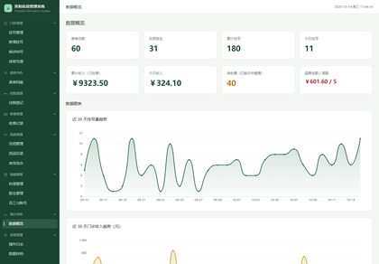
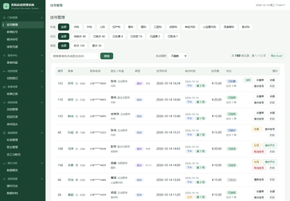
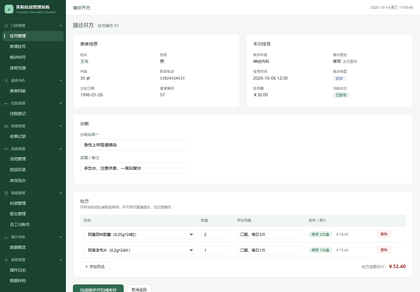
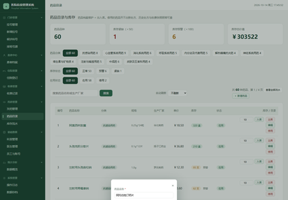
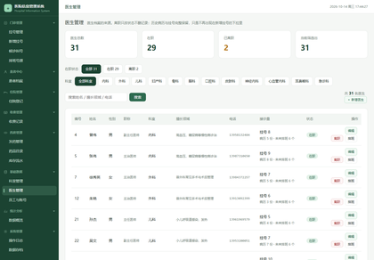

# 医院信息管理系统 - Web 前端（Flask）

在 [医院信息管理系统 · 数据库设计](../hospital_db_project/) 的基础上，加了一层 Web 界面，实现"浏览器里操作真实数据库"。
门诊主链路是一条**完整闭环**：**排班放号 → 挂号（占号源、领候诊号）→ 候诊叫号 → 接诊开方 → 收费 →
药房发药 →（退费时退款 + 退药 + 发药记录置为已退回）**，不是静态页面拼数据。

住院是一条**独立并行的小闭环**：**办理入院 → 在院观察 → 办理出院**。住院被建模成一张**住院登记单**
而不是患者身上的一个开关——同一位患者可以住很多次院，每住一次留一条记录，出院后还能再入院，历史全部可查。

另外带**登录与角色权限**，不同角色（挂号员 / 医生 / 药房 / 收费员 / 管理员）看到的菜单和能做的操作都不一样。

## 界面预览

> 以下为本机实际运行的截图（1440px 宽整页），点击缩略图可查看原尺寸。

<table>
  <tr>
    <td width="50%">
      <a href="docs/screenshots/01-dashboard.png"></a><br>
      <sub><b>首页</b> · 12 项关键指标（门诊 / 住院 / 收入 / 排班）+ 按权限显示的功能入口</sub>
    </td>
    <td width="50%">
      <a href="docs/screenshots/02-registrations.png"></a><br>
      <sub><b>挂号管理</b> · 科室 / 状态 / 初诊复诊筛选 + 姓名搜索 + 分页，叫号·接诊·收费·发药一站直达</sub>
    </td>
  </tr>
  <tr>
    <td width="50%">
      <a href="docs/screenshots/03-queue-call.png"></a><br>
      <sub><b>候诊叫号</b> · 按日期 / 时段 / 科室看各医生候诊队列，标出"下一位"，叫号后直接进入接诊</sub>
    </td>
    <td width="50%">
      <a href="docs/screenshots/04-visit-prescribe.png"></a><br>
      <sub><b>接诊开方</b> · 填诊断与医嘱 + 逐条开处方，实时算出处方金额，提交后扣库存并入账</sub>
    </td>
  </tr>
  <tr>
    <td width="50%">
      <a href="docs/screenshots/05-medicines.png"></a><br>
      <sub><b>药品管理</b> · 分类筛选 + 库存统计 + 新增药品弹窗，库存流水可对账</sub>
    </td>
    <td width="50%">
      <a href="docs/screenshots/06-doctors.png"></a><br>
      <sub><b>医生管理</b> · 在职 / 离职 / 未排班视图，科室与职称联动筛选，支持新增与改档</sub>
    </td>
  </tr>
</table>

## 功能

| 页面 | 地址 | 说明 |
|---|---|---|
| 登录 | `/login` | 账号密码登录（密码在库里存 scrypt 哈希），登录失败统一提示、不透露是账号错还是密码错 |
| 首页 | `/` | 系统门户：12 个关键指标（门诊 4 个 + 住院 4 个 + 收入/排班/患者/库存 4 个）+ 功能入口卡片（按权限显示） |
| 挂号管理 | `/registrations` | 挂号明细，科室 / 状态（含已收费、已发药、已退费）/ 初诊复诊筛选 + 姓名搜索 + 分页；展示**就诊日期、时段、候诊号**；**叫号、接诊开方、收费、发药、取消挂号、复诊挂号、打印挂号单、导出 Excel** |
| 接诊开方 | `/visit/<挂号号>` | 填诊断 + 开处方，提交后**自动扣减药品库存并入账**；库存不足会拦截 |
| 新增挂号 | `/add` | 支持"已有患者"与"新建患者（现场建档）"两种来源；科室与医生联动；**选就诊日期 + 上午/下午时段，实时显示该班次剩余号源** |
| **候诊叫号** | `/queue` | 按就诊日期 / 时段 / 科室看各医生的候诊队列（按候诊号排序），标出"下一位"；医师可逐个叫号并直接进入接诊 |
| **排班号源** | `/schedules` | 医生按天按上下午放号：号源 / 已挂 / 剩余 / 占用率进度条；支持**新增排班、停诊与恢复、调整号源**；已挂号的班次不允许直接停诊 |
| **药房发药** | `/dispenses` | 待发药 / 已发药 / 已退回三态；收费后由药师核对处方发药，退费时记录自动置为"已退回" |
| **收费管理** | `/charges` | 收费单列表：状态 / 支付方式筛选 + 单号或患者搜索 + 分页；顶部统计今日收入、累计收入、挂号费与药费拆分、退费金额 |
| **收费办理** | `/charge/<挂号号>` | 展示应收明细（挂号费 + 逐条药费）与合计**中文大写**；选支付方式收款入账，或对已收费单据退费 |
| **收费收据** | `/charge/<挂号号>/print` | 独立打印页，退费的单据上会盖"已退费"标注并写明退费时间与原因 |
| 患者管理 | `/patients` | 患者档案列表，含年龄、脱敏电话/身份证、累计挂号、待就诊次数；可导出 Excel、可直接改档 |
| 患者档案 | `/patient/<id>` | 基本信息 + 全部挂号记录 + 病历（处方明细可展开，显示每种药的数量、单价、小计） |
| **患者改档** | `/patient/<id>/edit` | 建档后更正姓名 / 性别 / 出生日期 / 电话 / 身份证 / 住址；身份证唯一性校验会排除自己那一条 |
| **住院管理** | `/admissions` | 在院 / 已出院 / 全部三种视图 + 科室筛选 + 患者姓名·住院号·床位·医生搜索 + 分页；顶部统计在院人数、今日入院、今日出院、累计住院人次；**在院患者可在列表里就地展开"办理出院"表单**（填出院时间与出院小结），并支持打印住院单、导出 Excel |
| **办理入院** | `/admission/new` | 选患者 + 住院科室 + 主治医生（联动）+ 床位号 + 入院诊断；**已在院的患者会被拦下并提示先办出院**；入院时间取办理时刻 |
| **住院单打印** | `/admission/<id>/print` | 独立打印页：在院显示"在院中"，已出院显示出院时间、出院小结与住院天数 |
| 药品目录 | `/medicines` | 药品目录与库存：**按 11 个分类筛选 + 在用/停用筛选**、库存分级（正常 / 预警 / 紧缺）、**新增药品 / 改目录信息 / 停用药品**、入库与出库操作、库存总价值 |
| 库存流水 | `/stock-logs` | 每一次出入库都有记录：变动前 / 变动后 / 原因，可按药品和类型筛选 |
| **科室管理** | `/depts` | 科室档案的新增 / 改名 / 改位置电话 / **停用与恢复**；显示每个科室的在职医生数与累计挂号量；**仅管理员可见** |
| **医生管理** | `/doctors` | 医生档案的新增 / 改职称科室擅长电话 / **离职与复职**；显示接诊量与未来排班数，附排班入口；**仅管理员可见** |
| 数据概览 | `/dashboard` | **ECharts 图表**（30 天挂号趋势、30 天收入趋势、科室对比、状态分布、医生排行、初复诊占比、支付方式占比）+ 明细表 |
| **操作日志** | `/logs` | 谁在什么时候、对哪条数据做了什么（登录、挂号、接诊、收费、退费、出入库）；**仅管理员可见** |
| **员工与账号** | `/staff` | 员工账号列表 + 新增员工 / 改角色改状态 / 重置密码 + 角色权限对照表；**仅管理员可见** |
| **数据存档** | `/backups` | 把当前数据库整体导出成一个命名快照，乱操作后一键恢复到任意快照；**仅管理员可见** |
| 打印挂号单 | `/registration/<id>/print` | 独立打印页，`@media print` 样式，可直接打印或存 PDF |

### 几个体验上的设计

- **左侧树形导航**：16 个入口按「门诊 / 患者 / 住院 / 收费 / 药房 / 基础数据 / 统计 / 系统」分成 8 组，
  可折叠且折叠状态记在 localStorage；窄屏自动收成抽屉，点左上角按钮滑出。
- **基础数据只在新增时候选里过滤停用项**：科室/医生/药品被停用后，它们不再出现在「新增挂号」「排班放号」
  「开处方」「办理入院」的下拉候选里，但列表页、历史病历、统计报表、导出的 Excel 里**照常显示**——
  停用是"不再接新业务"，不是"抹掉过去"。
- **弹窗一定有退路**：页面里的三套弹窗（基础数据的新增·编辑、住院管理的办理出院、患者档案的处方明细）
  都是「`<details>` 触发 → 面板 `position:fixed` 居中 → 整页遮罩」，而遮罩恰好会把触发用的
  `<summary>` 盖住，**一旦弹出来就再也点不到入口**。所以脚本统一给每个面板补四个出口：
  右上角 **×**、底部 **「取消」**（和「保存」并排）、按 **Esc**、点 **遮罩空白处**。
  统一在 `base.html` 里注入而不是逐个模板写，是为了以后加同类弹窗时不会再漏这一个。
- **候诊叫号弹窗**：叫号后整屏弹出大字号叫号窗口（候诊号、姓名、就诊科室与医生、叫号时间），
  顺便用浏览器的语音合成念一遍；可以一键"再叫一次"或直接进入接诊。关掉声音的选择会被记住。
- **列表页自动刷新**：挂号、叫号、收费、发药等列表页右上角有刷新间隔下拉（不刷新 / 10 秒 / 30 秒 /
  1 分钟 / 5 分钟），选择记在 localStorage，开着就能看到别人刚做的操作。
- **数据存档**：`snapshot.py` 不依赖 `mysqldump`，直接读表生成 SQL 文本（自动跳过生成列
  `admission.current_patient_id`，否则恢复时会报错）。恢复走同一个连接逐条执行，
  因为 `FOREIGN_KEY_CHECKS` 是会话级设置，换连接就失效了。

## 核心业务流程

```
                                 ┌────────────────────────── 已取消（释放号源）
                                 │
排班放号 ──> 挂号（占号源）──> 已挂号 ──> 候诊叫号 ──> 接诊开方 ──> 已就诊 ──> 收费 ──> 已收费 ──> 药房发药 ──> 已发药
                                                                              │                │            │
                                                                              └────────────────┴────────────┴──> 退费 ──> 已退费
                                                                                  （退款 + 药品退回库存 + 发药记录置「已退回」）
```

**接诊开方做的事（一个事务里完成）**：

```
1. 写病历  medical_record
2. 逐条写处方明细  prescription_detail
3. 扣减药品库存  medicine.stock
4. 记一条出库流水  medicine_stock_log（变动前 / 变动后）
5. 挂号状态改为「已就诊」
```

以上 5 步要么全部成功、要么全部回滚。若某味药库存不足，第 1 步已经写进去的病历也会一起撤销，
不会留下"有病历没扣药"的脏数据。

**收费做的事（一个事务里完成）**：

```
1. 校验挂号状态必须是「已就诊」（行级锁 FOR UPDATE，防止两人同时收费收两遍）
2. 算出应收明细：挂号费 + 处方里每一种药的 单价 × 数量
3. 写收费单  charge（单号 / 挂号费 / 药费 / 合计 / 支付方式 / 收费员）
4. 把每一笔费用写进收费明细  charge_detail —— 这是收费那一刻的"费用快照"，
   以后药品调价也不会把历史账目改掉
5. 挂号状态改为「已收费」
```

**挂号做的事（一个事务里完成）**：

```
1. 按"医生 + 就诊日期 + 时段"找到排班（不信任前端传的排班编号，自己按这三项查）
2. 校验排班存在且未停诊
3. 原子占号：UPDATE doctor_schedule SET booked_count = booked_count + 1
                WHERE schedule_id=? AND status='正常' AND booked_count < total_quota
   影响 0 行 = 号已挂完 / 已停诊，整笔挂号回滚——两个人抢最后一个号时只有一个人成功
4. 取候诊序号：同一位医生、同一就诊日，MAX(queue_no) + 1
5. 写挂号记录（含排班编号、时段、候诊号）
```
> 建档（新患者）与挂号在同一个事务里，挂号失败档案一起回滚。
> **取消挂号**会把 `booked_count` 减回去，把号释放出来给别人挂。

**药房发药做的事（一个事务里完成）**：

```
1. 锁住挂号行，校验状态必须是「已收费」（说明钱已收到、药可以出）
2. 校验确有"已收费"的收费单，且这条挂号没有发过药（dispense.reg_id 唯一约束兜底）
3. 写发药记录  dispense（药师 / 发药时间 / 关联病历）
4. 挂号状态改为「已发药」
```

**退费做的事（一个事务里完成）**：

```
1. 校验收费单状态必须是「已收费」，重复退费直接拒绝
2. 把本次收费里的药按快照数量全部退回库存，并各记一条「退药入库」流水
3. 若药已经发出过，把 dispense 记录置为「已退回」并填退回时间（反向流程留痕）
4. 收费单置为「已退费」，记录退费时间 / 原因 / 操作员
5. 挂号状态改为「已退费」（已收费、已发药两种状态都能退）
```

**住院登记做的事**：

```
办理入院（一个事务里完成）：
1. 校验患者存在，并对该患者这一行加锁（SELECT ... FOR UPDATE）
   —— 两个人同时点"办理入院"时只有一个能拿到锁
2. 查该患者有没有「在院」记录，有就直接拒绝并提示住院号与入院时间
3. 生成住院号 ZY + 日期 + 当日流水号（如 ZY202610140001）
4. 写住院单 admission：入院时间 = NOW()，状态「在院」，记下经办人
   —— 数据库层还有一道兜底：唯一索引只约束"在院"那一条记录，
      就算绕过应用层直接写库，也插不进第二条「在院」

办理出院：
1. 校验这条记录当前必须是「在院」，已出院的不能重复办
2. 校验出院时间不早于入院时间、不晚于此刻
3. 条件更新：status='已出院' + 出院时间 + 出院小结 + 经办人
   WHERE admission_id=? AND status='在院'（重复提交第二次影响 0 行）
```

> 住院和门诊是**两条并行的线**：门诊以「挂号」为单位，住院以「住院登记」为单位，
> 在院患者照样可以挂门诊号（真实医院里会诊、看别的科就是这么走的），两者互不干扰。

## 基础数据维护（科室 / 医生 / 药品 / 员工）

这四类数据是"主数据"——它们被历史业务数据引用着（科室牵着医生、医生牵着病历、药品牵着处方），
所以**一律只停用、不物理删除**：`department.status ∈ (启用/停用)`、`doctor.status ∈ (在职/离职)`、
`medicine.status ∈ (在用/停用)`、`staff.status ∈ (1/0)`。
硬删会连带毁掉历史记录（或被外键挡住），而"停用"只表达"不再接新业务"。

**两条铁律**

1. **停用只影响"新增时候选"**：下拉候选过滤掉停用项，但**列表页、历史病历、统计报表、
   导出的 Excel 全部照常显示**停用的科室 / 离职的医生 / 停用的药。
2. **过滤必须做两层**：前端的下拉过滤只是"好用"，**后端写操作会再查一遍库**——
   比如直接 POST 一条挂给离职医生的号、或给停用药开处方，都会被拦住并给出人话提示。

**几个值得说的实现**

- **新增药品要顺手补一笔入库流水**：这个系统的库存是**事件溯源**的——`medicine_stock_log` 是账本，
  药品的 `stock` 是流水滚出来的期末余额。所以新增药品时若填了期初库存，必须在**同一个事务**里
  往账本补一条 `change_type='入库'`、`before_stock=0`、`after_stock=stock` 的记录，
  否则"期初库存"就成了没有来源的凭空数字。
- **药品目录里改不了库存**：编辑药品时若试图直接改 `stock`，会被拒绝并提示"请走入库 / 出库"。
  库存只能由入库、出库、接诊扣减、退药回补这些**带流水的动作**改变，`stock` 本身不允许被直接赋值。
- **员工防自锁**：`_guard_admin_lockout()` 守两条不变量——(1) 不能停用或降级**当前登录的自己**；
  (2) 不能停用或降级**最后一个启用中的管理员**。违反任一条直接 flash 报错且不写库，
  模板上对应的按钮也会 `disabled` 并给出解释性 `title`。没有这道闸，管理员在页面上点两下就能把自己锁在系统外。
- **停用前先看影响面**：科室/医生列表里带了"在职医生数""累计挂号量""未来排班数"，
  停用前能一眼看出会影响多少业务，而不是盲停。

## 登录与角色权限

| 角色 | 演示账号 | 密码 | 能做什么 |
|---|---|---|---|
| 管理员 | `admin` | `admin123` | 全部功能，含**基础数据维护（科室 / 医生 / 员工账号）**、操作日志、数据存档 |
| 挂号员 | `gh01` | `123456` | 挂号（占号源）、取消挂号、现场建档、改档、排班管理、候诊叫号、收费、**住院登记（入院 / 出院）** |
| 医生 | `ys01` | `123456` | 候诊叫号、接诊开方、查看挂号与患者档案、**开住院单 / 办理出院** |
| 药房 | `yf01` | `123456` | **药房发药**、**药品目录维护（新增 / 改 / 停用）**、入库出库、库存流水、查看在院列表 |
| 收费员 | `sf01` | `123456` | 收费、**退费**、打印收据、查看在院列表 |

权限点（如 `reg.add`、`charge.do`、`schedule.manage`、`dept.manage`、`doctor.manage`、`medicine.manage`、`staff.manage`）
在 `app.py` 的 `ROLE_PERMS` 里定义，路由与权限的对应关系在 `ENDPOINT_PERMS`。
**没登记的路由默认"必须登录"**——白名单之外是收紧而不是放开。
只有**管理员**能进科室 / 医生 / 员工三个页面；**药品目录**是管理员与药房共有的（药房要能维护自己管的药）。

## 技术栈

- 后端：Python 3 + Flask 3.1
- 数据库：MySQL 8 + PyMySQL（事务 + 行级锁 `SELECT ... FOR UPDATE`）
- 前端：Jinja2 模板 + 原生 CSS + 原生 JavaScript（科室-医生联动、处方行动态增删、金额实时计算）
- 图表：ECharts 5.5（已本地化到 `static/echarts.min.js`，离线也能跑）
- 导出：openpyxl 生成 xlsx
- 登录：Flask `session` + `werkzeug.security` 的 `check_password_hash`（scrypt 哈希，不存明文密码）

## 目录结构

```
hospital_web/
├── app.py                    # 主程序，全部路由 + 权限表
├── db.py                     # 连接 / 查询 / 执行 / 事务 封装
├── snapshot.py               # 数据快照：整库导出成 SQL 文件 / 一键恢复
├── config.py                 # 数据库连接配置（自动读取同目录 config_local.py）
├── config_local.py           # 本机数据库密码（不进仓库，需自己创建）
├── requirements.txt          # 依赖清单
├── snapshots/                # 存档目录（每份存档是一个 .sql 文本）
├── templates/
│   ├── base.html             # 公共框架（左侧树形导航、自动刷新、按权限渲染）
│   ├── login.html            # 登录页（含演示账号表）
│   ├── home.html             # 首页门户
│   ├── registrations.html    # 挂号管理
│   ├── visit.html            # 接诊开方
│   ├── add.html              # 新增挂号（选日期/时段 + 号源余量提示）
│   ├── queue.html            # 候诊叫号（含整屏叫号弹窗 + 语音播报）
│   ├── schedules.html        # 排班号源管理
│   ├── charges.html          # 收费记录列表
│   ├── charge.html           # 收费办理（明细 / 收款 / 退费 / 发药）
│   ├── dispenses.html        # 药房发药
│   ├── patients.html         # 患者管理
│   ├── patient_detail.html   # 患者档案（含住院史）
│   ├── patient_edit.html     # 患者改档
│   ├── admissions.html       # 住院管理（在院 / 已出院 / 全部）
│   ├── admission_new.html    # 办理入院
│   ├── print_admission.html  # 住院单打印页
│   ├── medicines.html        # 药品目录与库存（分类筛选 + 新增/改/停用 + 入库出库）
│   ├── stock_logs.html       # 库存流水
│   ├── depts.html            # 科室管理（新增 / 改名 / 停用启用）
│   ├── doctors.html          # 医生管理（新增 / 改档 / 离职复职 + 排班入口）
│   ├── backups.html          # 数据存档（新建 / 恢复 / 删除快照）
│   ├── index.html            # 数据概览（含图表）
│   ├── logs.html             # 操作日志
│   ├── staff.html            # 员工与账号（新增 / 改角色 / 重置密码 / 防自锁）
│   ├── error.html            # 403 / 404 友好提示页
│   ├── print_registration.html  # 挂号单打印页
│   └── print_charge.html     # 收费收据打印页
├── static/
│   ├── style.css             # 样式
│   └── echarts.min.js        # 图表库（本地）
└── docs/
    └── screenshots/          # 界面截图（README 用）
```

## 运行步骤

1. 装依赖：
   ```
   pip install -r requirements.txt
   ```
2. 配置数据库密码：在本目录下新建 `config_local.py`，内容写
   ```python
   DB_CONFIG = {"password": "你的 MySQL root 密码"}
   ```
   （这个文件已被 `.gitignore` 排除、不会提交；也可以改用环境变量 `DB_PASSWORD`，见 `config.py` 注释）

3. 确认 MySQL 里已经有 `hospital_db`（先跑 [hospital_db_project](../hospital_db_project/)
   里的 `01_create_tables.sql`；想要饱满的演示数据就跑那边的 `python seed_demo_data.py`，它会自动补表补字段）
4. 测试连接：
   ```
   python db.py
   ```
   看到"连接成功！患者表共有 60 条记录"即可
5. 启动服务：
   ```
   python app.py
   ```
6. 浏览器打开 http://localhost:5000，用上表的账号登录（管理员 `admin` / `admin123`）

## 关键实现说明（面试可讲）

**数据库相关**

- **事务 + 行级锁**：接诊开方用 `with transaction()` 包住全部写操作，读药品库存时用
  `SELECT ... FOR UPDATE` 锁住该行，避免两个人同时开同一种药导致超卖；收费同样先锁住挂号行
- **号源不超卖**：把"号还有没有"和"占一个号"合成**一条条件更新**
  （`UPDATE ... WHERE booked_count < total_quota`），并发抢最后一个号时只有一个人影响 1 行，
  另一个人拿到 0 行直接提示"号已挂完"——比"先查再改"更可靠（后者在并发下有竞态窗口）
- **号源可释放**：取消挂号时 `booked_count` 减 1（`CASE WHEN ... > 0` 防负数），号重新可挂；
  已挂号的班次不允许在排班管理里直接停诊，避免"挂了号的患者没了医生"
- **就诊日期与挂号时间是两回事**：`registration.reg_date` 是"什么时候挂的号"（写入 `NOW()`），
  就诊日期则通过 `schedule_id` 关联到 `doctor_schedule.work_date` 得到——一天一个班次，
  结构上就不会出现"挂号时间和就诊日期对不上"的脏数据
- **候诊序号**：同一医生同一就诊日，`MAX(queue_no) + 1`，挂号时就定下来，叫号页按它排序
- **多表联查**：挂号列表关联 `registration` / `patient` / `doctor` / `department`；
  收费列表再关联 `charge`；患者档案一次取出该患者全部挂号与病历，处方明细用 `IN (...)` 一次查完
  再在 Python 里分组，避免循环查询
- **自关联外键**：`registration.parent_reg_id` 指向同表的 `reg_id`，表达"复诊对应哪次初诊"
- **建档与挂号同一事务**：挂号若失败，档案一起回滚，不会留下"建了档却没挂上号"的半截数据
- **费用快照**：`charge_detail` 存的是收费那一刻的单价与数量，不是引用 `medicine.price`，
  这样药品后来调价也不会篡改历史账目——这是财务数据的基本要求
- **单号生成**：`SF + 日期 + 当日流水号`（如 `SF202610140001`），`charge_no` 上有唯一索引兜底；
  万一并发撞号，`IntegrityError` 会被捕获并提示重试，而不是抛 500
- **唯一约束的友好处理**：`patient.id_card` 是唯一键，重复时事务内主动 `SELECT` 查一次，
  抛出业务异常并提示"已建档，患者是 XXX，请直接选择他"，而不是把数据库报错原样丢给用户
- **分组统计**：科室挂号量用 `GROUP BY` + `LEFT JOIN` 保证零挂号科室也显示；
  患者列表用 `COUNT` + `SUM(CASE WHEN ...)` 一次算出挂号 / 就诊 / 待就诊次数
- **参数化查询**：所有 SQL 用 `%s` 占位符传参，防止 SQL 注入
- **分页**：`LIMIT` + `OFFSET`，用 `COUNT(*)` 算总页数
- **用"生成列 + 唯一索引"表达"一堆记录里只能有一条"**：`admission` 表有一列
  `current_patient_id = IF(status = '在院', patient_id, NULL)`（STORED 生成列）并加了唯一索引。
  因为唯一索引**不约束 NULL**，于是"在院最多一条、已出院可以任意多条"这条规则由数据库自己保证，
  而不是靠应用层"先查再插"——后者在并发下有窗口，两个人同时办入院会双双通过
- **CHECK 约束兜住时间逻辑**：`ck_adm_time` 保证出院时间不早于入院时间；`ck_adm_discharge`
  保证"在院必须没有出院时间、已出院必须有出院时间"，状态和时间不会互相打架
- **时间精度陷阱**：入院时间入库用 `NOW()`（带秒），而出院时间来自 `datetime-local`（只到分钟）。
  直接比较会出现"同一分钟内办出院被判成时间倒流"；所以比较统一按分钟，
  写库前再把出院时间补足到不早于入院时刻，避免撞上 `ck_adm_time`

**权限与安全相关**

- **统一入口守卫**：用 `@app.before_request` 做全局拦截，未登录跳登录页、无权限返回 403，
  而不是在每个视图上重复写装饰器；`ENDPOINT_PERMS` 里没登记的路由默认要求登录，**默认收紧**
- **权限与视图分离**：导航、按钮的显示用模板里的 `can('charge.do')` 判断，但**后端每个写操作
  仍然独立校验一次**，前端隐藏只是"好用"，不是"安全"
- **条件更新防重**：状态变更写成 `UPDATE ... WHERE reg_id=? AND reg_status='已就诊'`，
  把"当前必须是某状态"放进 `WHERE` 而不是先查再改，重复点击第二次影响 0 行，页面提示"操作未生效"
- **退费不重复退钱、不重复退药**：收费单用 `WHERE charge_id=? AND charge_status='已收费'` 条件更新，
  药品退回也在同一个事务里，退费失败则退款和退药一起回滚
- **密码不存明文**：`werkzeug.security.generate_password_hash`（scrypt）+ `check_password_hash`；
  登录失败不区分"账号不存在"和"密码错误"，避免账号枚举
- **会话与开放重定向**：登录后跳转地址只接受以 `/` 开头且非 `//` 的路径；状态变更后的返回地址同理
- **防自锁**：员工管理里"停用 / 降级自己"和"停用 / 降级最后一个启用中的管理员"被服务端硬拦
  （`_guard_admin_lockout()` 两条不变量），前端按钮同步 `disabled` 并说明原因——
  权限系统最容易踩的坑不是"给多了"，而是管理员手一抖把自己关在门外
- **输入安全**：SQL 全部参数化——`where_sql` 只拼"代码里写死的片段"，用户输入一律走 `%s` 占位符；
  5 处注入 `<script>` 的 JSON（医生 / 药品 / 图表）全部经 `json_for_script()` 转义，
  把 `< > &` 换成 `\uXXXX` 并处理 U+2028/29，避免 `</script>` 提前闭合脚本标签；搜索关键词限长 50 字
  （防超长 URL 让 WSGI 直接回 431）；id 一律 `type=int` 转换，非法值退化成"无筛选"而不是报错。
  **实测 91 项断言全过**：SQL 注入 6 种载荷 × 5 个页面、XSS（医生名塞 `</script>`、患者姓名塞 ``）、
  200~5000 字超长输入、10 种分页越界、10 条非法筛选值、5 角色 × 6 敏感页越权矩阵、错误页信息泄露
- **双端校验**：科室与医生是否匹配、患者建档字段格式、支付方式是否合法，前端只管"好用"，
  后端全部再校验一遍
- **操作日志不影响主业务**：`log_action()` 吞掉异常——库存已经扣了，不能因为日志表出问题就把整单回滚
- **数据脱敏**：手机号保留前 3 位后 4 位（`138****5678`）、身份证保留前 6 位后 4 位

**工程细节**

- **Decimal 的处理**：数据库取出的金额是 `Decimal`，转 JSON 给前端前先转 `float`（否则 `json.dumps` 报错）
- **金额中文大写**：收据上的"壹佰贰拾捌元伍角"是自己写的 `rmb_upper()`，按 4 位一组处理万 / 亿，
  零的处理单独考虑了"整组为零"和"低位组补零"（如 1000005 → 壹佰万零伍元整）
- **提交失败回填**：接诊开方表单提交失败时把已填的处方行原样回填，不让用户白填一遍
- **排序稳定性**：所有列表用二级排序（如 `ORDER BY charge_time DESC, charge_id DESC`），同时间记录顺序固定
- **演示数据可复现**：`seed_demo_data.py` 固定随机种子 —— 今天以前的**历史数据每次执行逐条一致**；
  只有"今天"的记录会随执行时刻小幅浮动（可用的时间段变长），并且**所有演示时间都断言不晚于此刻**；
  库存流水是从处方倒推期初库存后逐条滚出来的，脚本内有断言保证"期末库存 == 声明的当前库存"，
  以及"收费单药费 == 收费明细药品项合计"
