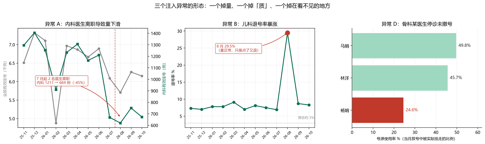

# 医院运营异常归因 Agent

用自然语言问一句「这个月门诊量为什么掉了」，Agent 自己决定查几步、查哪些维度，
最后给出**带证据链的归因结论**，并主动排除掉不该上报的正常波动。

## 一句话说清它和「智能问数」的区别

| | 智能问数（ChatBI） | 本项目 |
|---|---|---|
| 你问 | 「7 月挂号多少」 | 「7 月为什么掉了」 |
| 它做 | 查一个数给你 | 先确认现象 → 拆科室 → 换维度 → 钻明细 → 排除节假日 |
| 路径 | 固定，写死 SQL 就行 | 第 N 步查什么，取决于第 N-1 步查出什么 |
| 结论 | 一个数字 | 原因 + 证据 + 该不该上报 |

**为什么「总量降了 12%」这句没用**：它既可能是某个科室塌了，也可能是全院普降。
不往下拆，这句话等于没说。

## 三个必须换维度才能发现的异常

下图是数据里埋的三个异常。注意它们的形态完全不同：



| 异常 | 表面现象 | 真相 | 只看「总量」能发现吗 |
|---|---|---|---|
| **A** 内科 | 挂号量 1211 → 669（-45%） | 2 名医生离职，在岗从 4 人降到 2 人 | 能 |
| **B** 儿科 | 挂号总量**正常** | 退号率从 3% 涨到 29.5%，人点了又退 | **不能**，要换退号率维度 |
| **D** 骨科 | 科室总量基本正常 | 某医生停诊 10 天但排班没撤，号放了没人挂，使用率 24.6%（同事 46–50%） | **不能**，要拆到单医生 |

## 评测结果（12 个月全跑，不是挑好看的月份）

```
真异常检出   3/3   ['A', 'B', 'D']
假异常处理   正确判为非问题（未误报）
误报         0 条
持续性问题   3 条被正确标为「持续」而非新问题
平均步数     6.5
总耗时       40.7s（12 个月）
```

**对照组（证明不是「换个脚本也行」）：**

| 异常 | 单轮「智能问数」 | 多步归因 |
|---|---|---|
| A 内科 | 检出 | 检出 |
| B 儿科 | 漏（只看到量） | 检出 |
| D 骨科 | 漏（只看到量） | 检出 |
| | **1/3** | **3/3** |

## 两套决策层，同一个执行循环

决策层做成了可替换的，`run_agent` 的循环、三个刹车、工具执行完全不用改：

- **规则版**（默认，`HeuristicBrain`）：内置归因策略，零成本、结果确定
- **模型版**（`--llm`，`LLMBrain`）：同一套 tool schema 交给 DeepSeek，由模型决定下一步

```bash
python ops_agent.py 2026-07          # 规则版
python ops_agent.py 2026-07 --llm    # 模型版
```

**实测对比：**

| | 规则版 | 模型版（DeepSeek-chat） |
|---|---|---|
| 真异常检出 | 3/3 | 3/3（首次 2/3，见下） |
| 正常月份误报 | 0/8 | 0/2（抽查 2025-11、2026-05） |
| 单月耗时 | 4s | 20–25s |
| 单月 token | 0 | 1.8–4 万 |
| 结论质量 | 模板句，机械 | 有因果推理和处置建议 |

**一个真实的坑：模型第一次漏了骨科。**

第一版 system prompt 只说了「一步步查证」，模型在 2026-09 只查了挂号量，
把骨科 -14.3% 判成「正常波动」，完全没看号源使用率——而真正的异常（某医生 24.6%）就藏在那。
在 prompt 里加了一条硬性 checklist：

> 下结论前必须把三个维度都查过一遍——①挂号量 ②退号率 ③号源使用率。
> 少查任何一个都不许下结论，因为问题可能藏在任何一个维度里。

加上之后模型 11 步查完三个维度，主动下钻到人，并自己算出「杨娟一人把科室拉低约 7 个百分点，
几乎可以解释骨科全部偏离」。

**结论：模型不会自己保证覆盖率，覆盖率要靠外部约束（checklist / 规则）兜。**
这也是为什么默认走规则版——规则版可能结论呆板，但三个维度它一定会查。

## 三个设计决定

### 1. 科室之间不横向比，每个科室跟自己历史比

12 个科室规模不同（内科 4 个医生、眼科 2 个）。直接比绝对量，永远选出一堆小科室。
所以每个指标都拿「该科室前 11 个月的中位数」当基线，看偏离了多少。

**这一条改之前，Agent 报出来的是「耳鼻喉科退号率 10.7%」——那是 2 个医生小科室的随机波动。**

### 2. 先查日历，再钻科室

如果是春节导致的全院普降，就不该逐个科室查下去——那会报出一堆假问题。

第一版把日历检查放在最后，结果 2026-02 报了 5 个科室「挂号量下滑」。
调整顺序后，2026-02 在第 6 步就停：「全院降 31%，含春节，属正常波动」。

**这是「精确率」而非「召回率」的取舍：宁可少报，不要错报。**

### 3. 区分「新发问题」和「持续问题」

内科 7 月离职后，8、9、10 月都仍然偏低。如果每月都报「本月下滑」，看报告的人会以为连着出事。

现在会标成「挂号量持续偏低……上月 620 例，未见明显恢复，属持续性问题而非本月新增」。

## 数据

HIS 演示库只有 180 条挂号、1 个月跨度，分到「科室×周」后平均每格 3 条，噪声会盖住信号。
所以按 HIS 的业务模型（部门 / 医生 / 排班 / 挂号）造了一份 12 个月数据：

- 84,424 条挂号 · 5,654 条排班 · 12 科室 · 30 医生
- 固定随机种子，任何人重跑得到同一份
- **注入 4 个已知异常**（3 个真问题 + 1 个春节假异常），`gen_ops_data.py` 里明写

**数据是模拟的**，这一点不掩饰。它的价值在于「答案已知」——只有知道哪个月哪个科室因为什么掉量，
才能反过来检验 Agent 是归因到了真原因，还是编了一个听起来合理的理由。

## 当前限制（诚实说明）

1. **默认走规则版，不是大模型。** 规则版结果确定、零成本，但结论表述机械；
   `--llm` 切模型版，结论更专业，代价是每单月 2–4 万 token、20 多秒，
   且覆盖率要靠 prompt checklist 约束（见上一节）。
2. **模型版只抽查了 6 个月**（4 个异常月 + 2 个正常月），没有跑满 12 个月，
   所以「0 误报」这个数字只对规则版成立（8 个正常月份全跑过）。
3. **只读，不写。** 不做「AI 直接改患者数据」——医疗场景里改错没人担责。
   要写也只能写库存/主数据这类可回滚的，且必须二次确认 + 审计留痕。
4. 异常判定阈值（-25%、退号率翻倍、使用率 <35% 且低于同事 25%）是按这批数据定的，换医院要重标。

## 怎么跑

```bash
# 1. 造数据（会重建 hospital_ops 库）
python gen_ops_data.py

# 2. 查单月
python ops_agent.py 2026-07

# 3. 跑 12 个月评测 + 对照实验
python eval_agent.py

# 4. 出图
python make_ops_fig.py
```

依赖：Python 3.10+、pymysql、matplotlib；需要一个 MySQL 8 实例（连接信息见 `ops_agent.py` 顶部 `DB`）。

## 文件

| 文件 | 作用 |
|---|---|
| `gen_ops_data.py` | 造 12 个月数据 + 注入 4 个已知异常 |
| `ops_agent.py` | 5 个只读查询工具 + 决策循环 + 结论生成 |
| `eval_agent.py` | 12 个月评测 + 单轮对照实验 |
| `make_ops_fig.py` | 生成异常形态图 |
